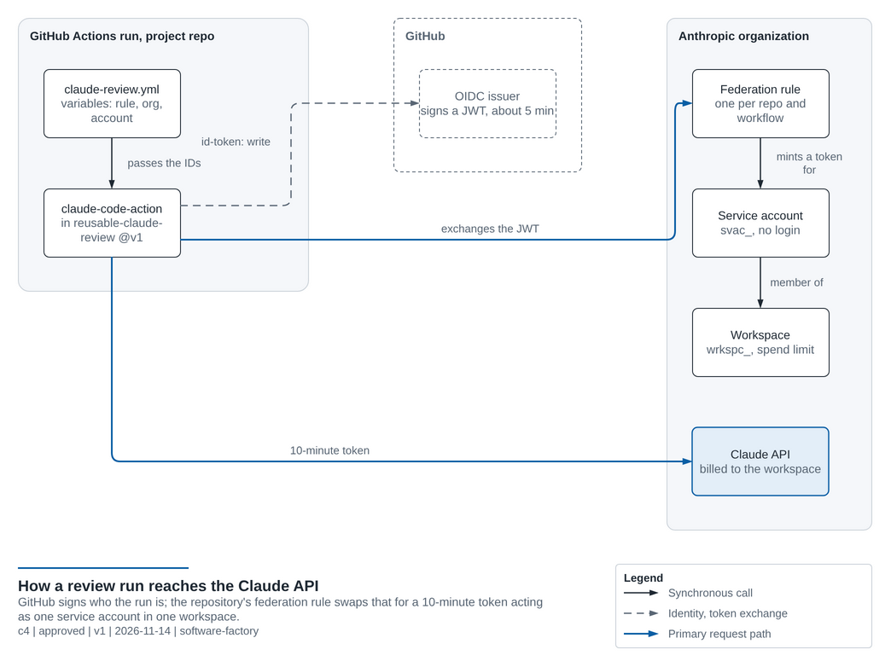
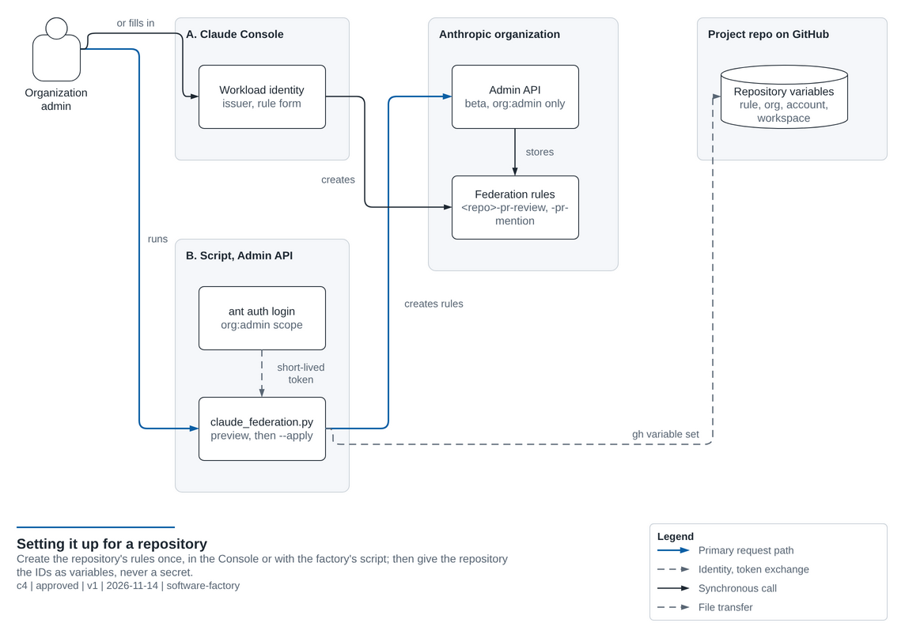

# Claude services: authentication

How the Claude review and `@claude` mentions ([SHARED-SERVICES.md](SHARED-SERVICES.md)) reach the Claude API, and how
to set that up for a repository: in the Claude Console, or with the factory's script. Adapted from
`egov-ai/claude-skills/docs/claude-code-review-auth.md`, where this setup has run since November 2026.

**In short:** no API key is stored anywhere. Each run proves who it is with a token GitHub signs, and a **federation
rule** for that repository swaps it for a Claude token that lives ten minutes. You create the rules once per
repository and give the repository their IDs as **variables** (identifiers, not secrets).



---

## The objects

| Where | Object | ID | What it is |
|---|---|---|---|
| GitHub | OIDC identity token | | A JWT GitHub signs for each run, valid about 5 minutes. Its `sub` (subject) names the repository and the event, for example `repo:egov-sofa/software-factory:pull_request`. The job needs `permissions: id-token: write`. |
| GitHub | Repository variables | | The IDs below, read by the caller workflow and passed to the factory's reusable workflow. |
| Anthropic | Workspace | `wrkspc_` | Where usage is counted and billed; give it a **spend limit**. |
| Anthropic | Service account | `svac_` | A non-human identity with no login, a member of the workspace. |
| Anthropic | Federation issuer | `fdis_` | "Tokens from `https://token.actions.githubusercontent.com` may be trusted." One per organization is enough. |
| Anthropic | Federation rule | `fdrl_` | "When a GitHub token for *this repository and event* arrives, mint a token for *this service account* in *this workspace* for 600 seconds." One per repository and workflow. |

The egov Anthropic organization already has the issuer, a service account and a workspace from the claude-skills
setup. A new repository usually needs **only new rules** and the variables. A separate workspace per team (for
example `software-factory-ci`) is worth it when you want its own spend limit.

## What each repository needs

| Rule (suggested name) | Matches | Repository variable |
|---|---|---|
| `<repo>-pr-review` | subject `<prefix>:pull_request`, audience `https://api.anthropic.com`, claim `repository_owner` | `ANTHROPIC_FEDERATION_RULE_ID` |
| `<repo>-pr-mention` (optional) | subject `<prefix>:ref:refs/heads/main`, claims `repository_owner` and `event_name: issue_comment` | `ANTHROPIC_MENTION_FEDERATION_RULE_ID` |

Plus the shared variables `ANTHROPIC_ORGANIZATION_ID`, `ANTHROPIC_SERVICE_ACCOUNT_ID`, `ANTHROPIC_WORKSPACE_ID`, and
`CLAUDE_REVIEW_ENABLED` set to `true`. Every rule uses scope `workspace:developer` and a token lifetime of 600 seconds.

- **`<prefix>`** is the repository's OIDC subject prefix. Read it with
  `gh api repos/OWNER/NAME/actions/oidc/customization/sub`: with GitHub's immutable subject format it holds the owner
  and repository IDs (`repo:egov-ai@333615140/claude-skills@1386710680`), and a rule written with the plain names
  never matches. With the default format it is `repo:OWNER/NAME`.
- **No `ref` claim on the review rule:** pull request runs carry `refs/pull/<number>/merge`, not a branch.
- **One rule per repository, even though the logic lives in the factory.** The token's subject is always the
  repository whose workflow started the run (the caller), not the factory that holds the reusable workflow. The
  factory's own repository needs rules like any project.
- **Optional hardening for the mention rule:** a `job_workflow_ref` claim pins the exact workflow file. For a job that
  calls a reusable workflow, GitHub sets it to the *reusable* workflow (for the factory itself
  `egov-sofa/software-factory/.github/workflows/reusable-claude-mention.yml@refs/heads/main`; for a project calling
  it at `@v1`, presumably `…@refs/tags/v1`). This is from GitHub's OIDC documentation and not yet tested here:
  if an exchange is refused on that claim, copy the value from the refusal in the Console.
- **No secret.** A repository secret `ANTHROPIC_API_KEY` or `CLAUDE_CODE_OAUTH_TOKEN` wins over federation; delete
  both when moving to federation.
- **API credit.** Usage is paid from the organization's API credit (Console, Billing), not from a Claude Pro or Max
  plan. Without credit every review fails with `Credit balance is too low`.

---

## Option A: in the Claude Console

You need the admin, owner or primary owner role in the Anthropic organization.

1. Read the repository's subject prefix:
   ```bash
   gh api repos/OWNER/NAME/actions/oidc/customization/sub
   ```
2. Console → [Workload identity](https://platform.claude.com/settings/workload-identity-federation). If the GitHub
   issuer exists, open it; otherwise **Connect workload** → **GitHub Actions** creates the issuer, a service
   account and a first rule.
3. On the GitHub issuer, create the **review rule** with the values in the table above (name, subject prefix,
   audience, claim, service account, workspace, scope `workspace:developer`, lifetime 600).
4. Optional: create the **mention rule** the same way.
5. Give the repository the IDs (the Console shows them on each object):
   ```bash
   gh variable set ANTHROPIC_FEDERATION_RULE_ID --repo OWNER/NAME --body fdrl_...
   ```
   ```bash
   gh variable set ANTHROPIC_ORGANIZATION_ID --repo OWNER/NAME --body <organization-id>
   ```
   ```bash
   gh variable set ANTHROPIC_SERVICE_ACCOUNT_ID --repo OWNER/NAME --body svac_...
   ```
   ```bash
   gh variable set ANTHROPIC_WORKSPACE_ID --repo OWNER/NAME --body wrkspc_...
   ```
   ```bash
   gh variable set CLAUDE_REVIEW_ENABLED --repo OWNER/NAME --body true
   ```
   and, with the mention rule:
   ```bash
   gh variable set ANTHROPIC_MENTION_FEDERATION_RULE_ID --repo OWNER/NAME --body fdrl_...
   ```
6. Test: push to an open pull request. The rule's authentication history in the Console shows each exchange and,
   for a refused one, the reason.

## Option B: with the factory's script (Admin API)



[`scripts/claude_federation.py`](../scripts/claude_federation.py) creates the same rules through the Anthropic
**Admin API** (beta), on the existing GitHub issuer, and prints the `gh variable set` commands with the real IDs.
It reads the subject prefix with `gh` itself, reuses a rule that already exists under the same name, and never
deletes anything, so it is safe to run again.

Prerequisites: the Anthropic Python SDK (`pip install anthropic`), the `ant` CLI and `gh`. The federation endpoints
accept only an **`org:admin` OAuth token**, never an API key:

```bash
ant auth login --profile admin --scope "org:admin"
```
```bash
unset ANTHROPIC_API_KEY; export ANTHROPIC_AUTH_TOKEN=$(ant auth print-credentials --profile admin --access-token)
```

Preview first (calls no Anthropic API and creates nothing), then apply:

```bash
python3 scripts/claude_federation.py --repo egov-sofa/software-factory --service-account svac_... --workspace wrkspc_... --mention
```
```bash
python3 scripts/claude_federation.py --repo egov-sofa/software-factory --service-account svac_... --workspace wrkspc_... --mention --apply
```

Run the printed `gh variable set` commands, then switch back to your normal profile
(`unset ANTHROPIC_AUTH_TOKEN && ant profile activate default`). Other options: `--sub-prefix` when `gh` cannot read
it, `--rule-prefix` to choose the rule names, `--mention-workflow-ref` for the hardening claim above,
`--create-issuer` in an organization that has no GitHub issuer yet. `--help` lists them all.

**Automating it further.** The script needs a person with an `org:admin` login. A pipeline could run it unattended
with a federation rule whose scope is `org:admin`, targeting an admin service account; Anthropic requires a person to
create that one rule in the Console, and it is powerful (it can change the whole organization), so the factory does
not set one up.

## Option C: Terraform

No Terraform provider for Anthropic organization resources (workspaces, service accounts, federation issuers and
rules) appears in Anthropic's documentation or tooling we checked in November 2026. To keep the rules as code today,
keep them in this script (reviewed in pull requests) or in JSON payloads for the Admin API. Revisit when a provider
exists (roadmap I16).

---

## Other ways to authenticate

| | Workload identity federation | API key | OAuth token |
|---|---|---|---|
| Stored in GitHub | nothing secret: variables with IDs | secret `ANTHROPIC_API_KEY` (a **workspace** key; an organization-level key fails with `not scoped to a workspace`) | secret `CLAUDE_CODE_OAUTH_TOKEN` from `claude setup-token` |
| Lifetime | 10 minutes, minted per run | until revoked | long-lived |
| Billed to | the rule's workspace | the key's workspace | the Claude plan of the person who created it |
| Use it | **default for the factory** | quick start, if federation is not possible | not recommended |

To turn the Claude review off instead, set `CLAUDE_REVIEW_ENABLED` to anything but `true`: the job is then skipped.

## Troubleshooting

| Symptom in the review job's log | Cause | Fix |
|---|---|---|
| `Environment variable validation failed: Either ANTHROPIC_API_KEY, CLAUDE_CODE_OAUTH_TOKEN, or workload identity federation … is required` | `CLAUDE_REVIEW_ENABLED` is `true` but the repository has none of the variables (what happened on egov-sofa/software-factory#6) | Create the rule and set the variables (Option A or B), or set `CLAUDE_REVIEW_ENABLED` to `false` |
| The exchange is refused; the Console shows a subject mismatch | The rule uses the short form `repo:OWNER/NAME:…` but the repository sends the immutable form with IDs | Re-read the prefix with `gh api …/actions/oidc/customization/sub` and fix the rule |
| Refused on a claim (`job_workflow_ref`, `event_name`) | The value GitHub sends differs from the rule | Copy the value from the refusal details into the rule |
| `workspace_id_required` | The rule covers several workspaces | Set `ANTHROPIC_WORKSPACE_ID` |
| `401 Invalid bearer token` while federation is set up | A secret `ANTHROPIC_API_KEY` or `CLAUDE_CODE_OAUTH_TOKEN` exists and wins | Delete the secret |
| `Credit balance is too low` | No API credit in the organization | Console, Billing |
| No review and no message | Claude's messages are hidden by default | Set `CLAUDE_REVIEW_DEBUG` to `true`, rerun, read the log, then delete the variable |
| The mention job is skipped | `ANTHROPIC_MENTION_FEDERATION_RULE_ID` is not set | Create the mention rule and set the variable |
