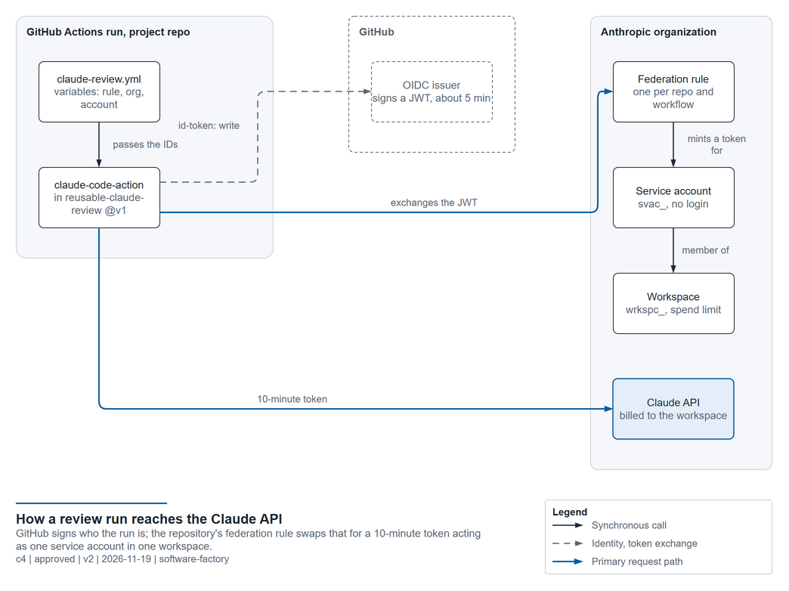
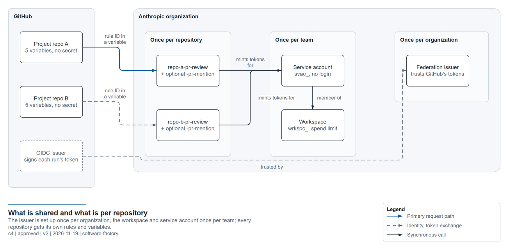

# Claude services: authentication

How the Claude review and `@claude` mentions ([SHARED-SERVICES.md](SHARED-SERVICES.md)) reach the Claude API, and how
to set that up for a repository: from Claude Code with one command (recommended), or by hand in the Claude Console.
Adapted from `egov-ai/claude-skills/docs/claude-code-review-auth.md`, where this setup has run since November 2026.

**In short:** no API key is stored anywhere. Each run proves who it is with a token GitHub signs, and a **federation
rule** for that repository swaps it for a Claude token that lives ten minutes. Each repository needs its own rules
and its own **variables** (identifiers, not secrets). `/factory-new` and `/factory-onboard` prepare both, and an
organization admin finishes the job with one command: see
[Set up a repository from Claude Code](#set-up-a-repository-from-claude-code-recommended).

| You want to | Read |
|---|---|
| understand how a review run gets its access | [Architecture](#architecture) |
| set up a new or existing repository | [Set up a repository from Claude Code](#set-up-a-repository-from-claude-code-recommended) |
| fix a failing review | [Troubleshooting](#troubleshooting) |

---

## Architecture

### A review run, step by step



1. A pull request starts the project's `claude-review.yml`. It reads the repository **variables** (rule, organization,
   service account and workspace IDs) and passes them to the factory's reusable workflow at `@v1`.
2. In that workflow, `claude-code-action` asks GitHub's **OIDC issuer** for an identity token (a JWT, about five
   minutes). The job may do so because it has `permissions: id-token: write`. The token says which repository,
   event and workflow the run is; nobody can forge it.
3. The action sends the JWT to the Anthropic **federation rule** named in the variables. The rule checks the subject
   and the claims (repository, owner ID, event, and optionally the exact workflow file). If they match, it mints a
   Claude token for its **service account**, in its **workspace**, valid 600 seconds.
4. The action calls the **Claude API** with that token. Usage is billed to the workspace and limited by its spend
   limit.

Nothing in the repository is secret, so there is nothing to leak or rotate: a stolen variable is useless without a
run that GitHub signed for the repository the rule names.

### What is shared and what is per repository



| Object | How many | Created by |
|---|---|---|
| Federation issuer (GitHub) | one per Anthropic organization, already there | once, in the Console (or the script's `--create-issuer`) |
| Workspace and service account | one per team or project group | once, in the Console |
| Federation rules | one or two per repository (review, optional mention) | the script, for each repository |
| Repository variables | five per repository (six with the mention rule) | the script with `--set-variables`, for each repository |

The rules are per repository because the token always names the repository whose workflow started the run (the
caller), never the factory. That is why every new repository needs a setup run, and why the factory automates it.

## The objects

| Where | Object | ID | What it is |
|---|---|---|---|
| GitHub | OIDC identity token | | A JWT GitHub signs for each run, valid about 5 minutes. Its `sub` (subject) names the repository and the event, for example `repo:egov-sofa/software-factory:pull_request`. The job needs `permissions: id-token: write`. |
| GitHub | Repository variables | | The IDs below, read by the caller workflow and passed to the factory's reusable workflow. |
| Anthropic | Workspace | `wrkspc_` | Where usage is counted and billed; give it a **spend limit**. |
| Anthropic | Service account | `svac_` | A non-human identity with no login, a member of the workspace. |
| Anthropic | Federation issuer | `fdis_` | "Tokens from `https://token.actions.githubusercontent.com` may be trusted." One per organization is enough. |
| Anthropic | Federation rule | `fdrl_` | "When a GitHub token for *this repository and event* arrives, mint a token for *this service account* in *this workspace* for 600 seconds." One per repository and workflow. |

**Share the issuer, separate the rest.** The egov Anthropic organization already has the GitHub issuer (from the
claude-skills setup); every repository uses it. Give the factory, and later each team or project group, **its own
workspace and service account** (for example `software-factory-ci`):

| Object | Shared or separate | Why |
|---|---|---|
| Federation issuer (GitHub) | shared, one per organization | it only says "trust GitHub's tokens" |
| Workspace | separate | its own spend limit and usage report; a runaway loop in one repository cannot spend another's budget (roadmap E6.4) |
| Service account | separate | every call in the logs is attributable to one repository's identity (E1.5) |
| Federation rules | always separate | each matches one repository and one workflow |

Reusing claude-skills' workspace and service account works, but mixes the two repositories' cost and audit trail, and
ties the factory to objects that would leave with claude-skills' work skills if they ever moved organization.

## What each repository needs

| Rule (suggested name) | Matches | Repository variable |
|---|---|---|
| `<repo>-pr-review` | subject `<prefix>:pull_request`, audience `https://api.anthropic.com`, claims `repository_owner`, `repository_owner_id` and `event_name: pull_request` | `ANTHROPIC_FEDERATION_RULE_ID` |
| `<repo>-pr-mention` (optional) | subject `<prefix>:ref:refs/heads/main`, claims `repository_owner`, `repository_owner_id` and `event_name: issue_comment` | `ANTHROPIC_MENTION_FEDERATION_RULE_ID` |

Plus the shared variables `ANTHROPIC_ORGANIZATION_ID`, `ANTHROPIC_SERVICE_ACCOUNT_ID`, `ANTHROPIC_WORKSPACE_ID`, and
`CLAUDE_REVIEW_ENABLED` set to `true`. Every rule uses scope `workspace:developer` and a token lifetime of 600 seconds.

- **`<prefix>`** is the repository's OIDC subject prefix. Read it with
  `gh api repos/OWNER/NAME/actions/oidc/customization/sub`: with GitHub's immutable subject format it holds the owner
  and repository IDs (`repo:egov-ai@333615140/claude-skills@1386710680`), and a rule written with the plain names
  never matches. With the default format it is `repo:OWNER/NAME`.
- **`repository_owner_id`** is the owner's numeric ID (`gh api users/OWNER --jq .id`, which answers for organizations
  too). With it the rule trusts the organization itself, not only its name: if `egov-sofa` were ever renamed or
  deleted, GitHub would release the name for anyone to register, and their tokens would otherwise match.
- **No `ref` claim on the review rule:** pull request runs carry `refs/pull/<number>/merge`, not a branch.
- **One rule per repository, even though the logic lives in the factory.** The token's subject is always the
  repository whose workflow started the run (the caller), not the factory that holds the reusable workflow. The
  factory's own repository needs rules like any project.
- **Optional hardening for the mention rule:** a `job_workflow_ref` claim pins the exact workflow file. For a job that
  calls a reusable workflow, GitHub sets it to the *reusable* workflow (for the factory itself
  `egov-sofa/software-factory/.github/workflows/reusable-claude-mention.yml@refs/heads/main`; for a project calling
  it at `@v1`, presumably `…@refs/tags/v1`). This is from GitHub's OIDC documentation and not yet tested here:
  if an exchange is refused on that claim, copy the value from the refusal in the Console.
- **Recommended hardening for the review rule:** on `pull_request`, GitHub takes the workflow from the pull
  request's branch. Without a `job_workflow_ref` claim, anyone with write access can open a pull request that edits
  the workflow (or adds a job with `id-token: write`) and exchange its token for Claude API credentials. For a
  project calling the factory at `@v1`, require
  `egov-sofa/software-factory/.github/workflows/reusable-claude-review.yml@refs/tags/v1`
  (`--review-workflow-ref` in the script): the caller cannot add steps to the called job, and the tag is not under
  the pull request's control. In the factory itself the reusable workflow is local, so its ref is the pull request's;
  there the protection is the `protect-main` ruleset and keeping write access to maintainers. Fork pull requests get
  no token at all.
- **No secret.** A repository secret `ANTHROPIC_API_KEY` or `CLAUDE_CODE_OAUTH_TOKEN` wins over federation; delete
  both when moving to federation.
- **API credit.** Usage is paid from the organization's API credit (Console, Billing), not from a Claude Pro or Max
  plan. Without credit every review fails with `Credit balance is too low`.

---

## Set up a repository from Claude Code (recommended)

One person with the Anthropic **`org:admin`** role and **admin access to the GitHub repository** runs one command.
`/factory-new` (after creating the GitHub repository) and `/factory-onboard` (when you choose the Claude review) walk
you to it: Claude prepares and previews, you run the command. Claude never runs it itself, because it uses your
admin login.


### Once per machine

1. Install the tools: `gh` (logged in with `gh auth login`), the `ant` CLI, and the Anthropic Python SDK
   (`pip install anthropic`).
2. Optional, so you never type the IDs: put your team's service account and workspace in your shell profile.
   ```bash
   export FACTORY_CLAUDE_SERVICE_ACCOUNT=svac_...
   export FACTORY_CLAUDE_WORKSPACE=wrkspc_...
   ```
   Without them, pass `--service-account` and `--workspace` on the command line. The workspace and service account
   must already exist (Console, Settings → Workspaces; one per team, see [Architecture](#architecture)).

### For each repository

0. **The Claude GitHub app is installed on the repository** (<https://github.com/apps/claude>, or
   `/install-github-app` in Claude Code). Installing it once for the whole organization with "All repositories"
   covers new repositories too. Without it the review fails even with everything below in place, and the script
   cannot check it for you.
1. **Claude previews.** The skill runs the script without `--apply`. Nothing is created and no Anthropic API is
   called; it shows the rules it would create and the variables it would set. Check the repository name and the IDs.
2. **You log in** with the `org:admin` scope (once per session; the login lasts until it expires):
   ```bash
   ant auth login --profile admin --scope "org:admin"
   ```
3. **You run the one command** the skill hands over, in Claude Code with `!` in front, or in a terminal:
   ```bash
   env -u ANTHROPIC_API_KEY ANTHROPIC_AUTH_TOKEN="$(ant auth print-credentials --profile admin --access-token)" \
     python3 <factory>/scripts/claude_federation.py --repo OWNER/NAME --mention \
     --review-workflow-ref egov-sofa/software-factory/.github/workflows/reusable-claude-review.yml@refs/tags/v1 \
     --apply --set-variables
   ```
   The admin token exists only for this one process: it is not exported into your shell, and `env -u` makes sure an
   API key in your environment cannot get in the way.
4. **The script does the rest, in this order:**
   1. reads the repository's OIDC subject prefix and the owner's numeric ID with `gh`;
   2. creates the review rule and the mention rule on the existing GitHub issuer, or reuses rules that already
      exist under the same names (it never deletes anything, so running it twice is safe);
   3. checks that the repository's workflows cannot see an `ANTHROPIC_API_KEY` or `CLAUDE_CODE_OAUTH_TOKEN` secret,
      its own or its organization's. Such a secret wins over federation, and with both set every review fails with
      `401`. If it finds one, it **sets nothing** and stops: a review that works with that key today keeps working.
      Delete the secret (`gh secret delete NAME --repo OWNER/NAME`, or `--org OWNER`) and run the same command again;
   4. sets the variables with `gh variable set`: the rule IDs, the organization, the service account, the workspace,
      and **`CLAUDE_REVIEW_ENABLED` last**. If one fails, it stops there, so the review is never turned on without
      the IDs it needs.
5. **Check it works:** the next pull request gets the Claude review. The rule's authentication history in the Console
   shows each token exchange, and the reason for a refused one ([Troubleshooting](#troubleshooting)).

Why a person and not a pipeline: see "Automating it further" under Option B.

## Option A: in the Claude Console

You need the admin, owner or primary owner role in the Anthropic organization.

1. Read the values you will type in:
   ```bash
   gh api repos/OWNER/NAME/actions/oidc/customization/sub
   ```
   ```bash
   gh api users/OWNER --jq .id
   ```
2. If the factory's workspace does not exist yet, create it first (Settings → Workspaces, with a spend limit): the
   wizard can only pick an existing one.
3. Console → [Workload identity](https://platform.claude.com/settings/workload-identity-federation) → **Connect
   workload** → **GitHub Actions**, on the existing GitHub issuer. In step 2, *Federation rule*:

   | Field | Review rule | Mention rule (optional, run the wizard again) |
   |---|---|---|
   | Rule name | `<repo>-pr-review` (the script then recognises it) | `<repo>-pr-mention` |
   | GitHub organization | `OWNER` (required even if you use the advanced options) | same |
   | Repository | `NAME`, never blank (blank matches every repository of the owner) | same |
   | Branch / ref | **blank** | `refs/heads/main` |
   | Allowed events | **pull_request**: the default *Only push* never matches a review | `issue_comment` |
   | Organization numeric ID | the number from step 1 | same |
   | Enable in workspaces | only the factory's workspace; **not** *All workspaces* | same |
   | Advanced rule options | lifetime `600`, scope `workspace:developer` | same |

   **Advanced match options** replace the guided fields once you edit them, including the numeric ID. If you use
   them (for example because the event you need is not in the list), put everything there:

   | Field | Review rule | Mention rule |
   |---|---|---|
   | Subject pattern | `<prefix>:pull_request` (exact, no `*`) | `<prefix>:ref:refs/heads/main` |
   | Claim `repository_owner` | `OWNER` | `OWNER` |
   | Claim `repository_owner_id` | the number from step 1 | same |
   | Claim `event_name` | `pull_request` | `issue_comment` |
   | Expected audience | `https://api.anthropic.com` (or blank, the default) | same |
   | CEL condition | blank | blank |

   Step 3, *Target*: a **new** service account for the factory (or the team), a member of that workspace only.
   Step 4, *Test*: optional; the real test is the next pull request.
4. Check the saved rule in the Console: the subject must end in `:pull_request` and no `ref` or push event may be
   left over from the guided fields.
5. Give the repository the IDs (the Console shows them on each object):
   ```bash
   gh variable set ANTHROPIC_FEDERATION_RULE_ID --repo OWNER/NAME --body fdrl_...
   ```
   ```bash
   gh variable set ANTHROPIC_ORGANIZATION_ID --repo OWNER/NAME --body <organization-id>
   ```
   ```bash
   gh variable set ANTHROPIC_SERVICE_ACCOUNT_ID --repo OWNER/NAME --body svac_...
   ```
   ```bash
   gh variable set ANTHROPIC_WORKSPACE_ID --repo OWNER/NAME --body wrkspc_...
   ```
   ```bash
   gh variable set CLAUDE_REVIEW_ENABLED --repo OWNER/NAME --body true
   ```
   and, with the mention rule:
   ```bash
   gh variable set ANTHROPIC_MENTION_FEDERATION_RULE_ID --repo OWNER/NAME --body fdrl_...
   ```
6. Test: push to an open pull request. The rule's authentication history in the Console shows each exchange and,
   for a refused one, the reason.

## Option B: with the factory's script (Admin API)

The script the recommended setup uses, run by hand. The diagram is in
[Set up a repository from Claude Code](#set-up-a-repository-from-claude-code-recommended).

[`scripts/claude_federation.py`](../scripts/claude_federation.py) creates the same rules through the Anthropic
**Admin API** (beta), on the existing GitHub issuer, and prints the `gh variable set` commands with the real IDs, or
with `--set-variables` sets them itself (`CLAUDE_REVIEW_ENABLED` last).
It reads the subject prefix and the owner's numeric ID with `gh` itself (or takes `--sub-prefix` and `--owner-id`),
reuses a rule that already exists under the same name, and never deletes anything, so it is safe to run again. A
reused rule is not compared with what the script would create: if it was made in the Console, check its match there.

Prerequisites: the Anthropic Python SDK (`pip install anthropic`), the `ant` CLI and `gh`. The federation endpoints
accept only an **`org:admin` OAuth token**, never an API key:

```bash
ant auth login --profile admin --scope "org:admin"
```
```bash
unset ANTHROPIC_API_KEY; export ANTHROPIC_AUTH_TOKEN=$(ant auth print-credentials --profile admin --access-token)
```

Preview first (calls no Anthropic API and creates nothing), then apply:

```bash
python3 scripts/claude_federation.py --repo egov-sofa/software-factory --service-account svac_... --workspace wrkspc_... --mention
```
```bash
python3 scripts/claude_federation.py --repo egov-sofa/software-factory --service-account svac_... --workspace wrkspc_... --mention --apply
```

Run the printed `gh variable set` commands (or add `--set-variables` to the `--apply` run), then switch back to your
normal profile (`unset ANTHROPIC_AUTH_TOKEN && ant profile activate default`). Other options: `--sub-prefix` when
`gh` cannot read it, `--rule-prefix` to choose the rule names, `--mention-workflow-ref` for the hardening claim above,
`--create-issuer` in an organization that has no GitHub issuer yet. `--service-account` and `--workspace` default to
`$FACTORY_CLAUDE_SERVICE_ACCOUNT` and `$FACTORY_CLAUDE_WORKSPACE`. `--help` lists them all.

**Automating it further.** The script needs a person with an `org:admin` login. A pipeline could run it unattended
with a federation rule whose scope is `org:admin`, targeting an admin service account; Anthropic requires a person to
create that one rule in the Console, and it is powerful (it can change the whole organization), so the factory does
not set one up.

## Option C: Terraform

No Terraform provider for Anthropic organization resources (workspaces, service accounts, federation issuers and
rules) appears in Anthropic's documentation or tooling we checked in November 2026. To keep the rules as code today,
keep them in this script (reviewed in pull requests) or in JSON payloads for the Admin API. Revisit when a provider
exists (roadmap I16).

---

## Other ways to authenticate

| | Workload identity federation | API key | OAuth token |
|---|---|---|---|
| Stored in GitHub | nothing secret: variables with IDs | secret `ANTHROPIC_API_KEY` (a **workspace** key; an organization-level key fails with `not scoped to a workspace`) | secret `CLAUDE_CODE_OAUTH_TOKEN` from `claude setup-token` |
| Lifetime | 10 minutes, minted per run | until revoked | long-lived |
| Billed to | the rule's workspace | the key's workspace | the Claude plan of the person who created it |
| Use it | **default for the factory** | quick start, if federation is not possible | not recommended |

To turn the Claude review off instead, set `CLAUDE_REVIEW_ENABLED` to anything but `true`: the job is then skipped.

## Troubleshooting

| Symptom in the review job's log | Cause | Fix |
|---|---|---|
| `Environment variable validation failed: Either ANTHROPIC_API_KEY, CLAUDE_CODE_OAUTH_TOKEN, or workload identity federation … is required` | `CLAUDE_REVIEW_ENABLED` is `true` but the repository has none of the variables (what happened on egov-sofa/software-factory#6) | Create the rule and set the variables (Option A or B), or set `CLAUDE_REVIEW_ENABLED` to `false` |
| `match_claim_value_mismatch` in the rule's authentication history; the job log shows Claude starting and then `is_error: true` at no cost | The subject matched but a claim did not. Seen here on 2026-11-16, with the Console wizard. Usual causes: `event_name` left at the wizard's default **push** (a review sends `pull_request`); a `ref` condition such as `refs/heads/main` (a review sends `refs/pull/<n>/merge`); `repository_owner_id` holding the repository's or a user's ID instead of the owner's; a `job_workflow_ref` claim on the review rule (it ends in `@refs/pull/<n>/merge`, different on every pull request) | Open the refused exchange: it names the claim and both values. Fix that condition on the rule, then rerun the job (no push needed) |
| The review check passes in seconds but posts nothing; the log says "Workflow validation failed … identical content to the version on the repository's default branch" | The pull request changes `.github/workflows/claude-review.yml` itself, and the action refuses to run a review workflow that differs from the default branch (a safety rule). Seen on egov-sofa/software-factory#7 | Expected: the review runs again on the next pull request after the merge |
| The exchange is refused; the Console shows a subject mismatch | The rule uses the short form `repo:OWNER/NAME:…` but the repository sends the immutable form with IDs | Re-read the prefix with `gh api …/actions/oidc/customization/sub` and fix the rule |
| Refused on a claim (`job_workflow_ref`, `event_name`) | The value GitHub sends differs from the rule | Copy the value from the refusal details into the rule |
| `workspace_id_required` | The rule covers several workspaces | Set `ANTHROPIC_WORKSPACE_ID` |
| `401 Invalid bearer token` while federation is set up | A secret `ANTHROPIC_API_KEY` or `CLAUDE_CODE_OAUTH_TOKEN` exists and wins | Delete the secret |
| `Credit balance is too low` | No API credit in the organization | Console, Billing |
| The script stops with `gh could not set ... needs admin access` | `--set-variables` runs `gh variable set`, which needs admin access to the repository | Run it as a repository admin; it reuses the rules it already created, and nothing after the failed variable was set, `CLAUDE_REVIEW_ENABLED` included |
| The script stops with `can use the secret(s) ... Nothing was set` | An older setup with a stored key, in the repository or its organization; with the federation variables also set every review would fail with 401, so the script changed nothing | `gh secret delete NAME --repo OWNER/NAME` (or `--org OWNER` for an organization secret), then run the same command again (it reuses the rules) |
| `--service-account must be a service account ID ... or set FACTORY_CLAUDE_SERVICE_ACCOUNT` | Neither the option nor the environment variable is set | Pass the option, or export the variable (see [Once per machine](#once-per-machine)) |
| No review and no message | Claude's messages are hidden by default | Set `CLAUDE_REVIEW_DEBUG` to `true`, rerun, read the log, then delete the variable |
| The mention job is skipped | `ANTHROPIC_MENTION_FEDERATION_RULE_ID` is not set | Create the mention rule and set the variable |
