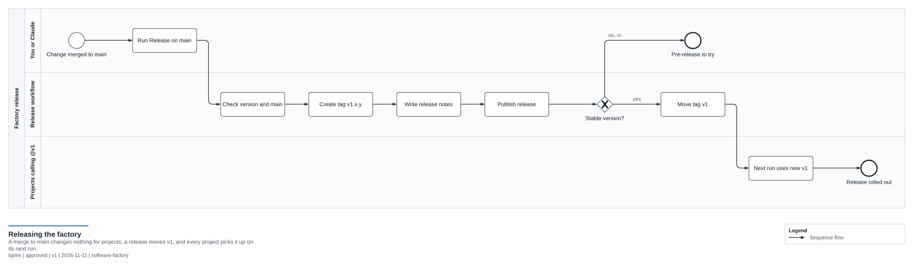
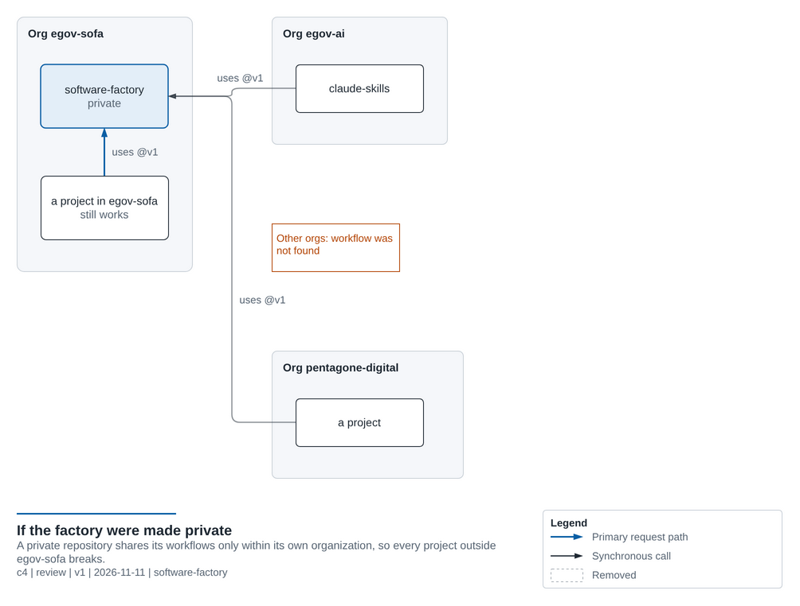

# Customizing the Factory

The factory is meant to grow with you. The golden rule:

> **Edit files in `/c/DEV/PROJECTS/gitHub/egov-rdc/egov-sofa/software-factory/`, never in `~/.claude/` directly.** Then run `scripts/install.sh` again and commit your change. Otherwise your edits are lost on the next install and are never backed up to GitHub.

---

## Change how an agent behaves

Open `claude/agents/<name>.md`. The top section (between `---` lines) is **frontmatter**:

```yaml
---
name: reviewer
description: When Claude should use this agent (Claude reads this to decide)
tools: Read, Grep, Glob, Bash   # what it's allowed to do; leave out Edit/Write = read-only
model: opus                     # opus | sonnet | haiku | inherit
---
```

Everything below is the agent's instructions, written in plain English. Edit them like a job description.

After changing the frontmatter of an agent or skill, run `python scripts/validate.py`. It catches a misspelled key,
a `name` that does not match the file, an unknown model or tool, and a write tool given to a read-only agent; the
self-test runs it on every pull request too.

## Add a new agent

Create `claude/agents/my-agent.md` with the same structure, then run `install.sh`. Ideas:
- `ui-designer`: checks accessibility and responsive layout
- `db-migrator`: writes and checks database migrations
- `perf-auditor`: looks for slow code and N+1 queries

To include it in the pipeline, add a step to `claude/skills/factory-build/SKILL.md`.

## Add a new template (e.g. Go, .NET, Java)

1. Create `templates/<name>/` with the language-specific files.
2. Put a `CLAUDE.md` in it (it replaces the shared one) listing the exact build, test and lint commands.
3. Add `.github/workflows/ci.yml`. Either call an existing reusable workflow or create `reusable-<name>.yml` in `.github/workflows/`.
4. Add the template to the matrix in `.github/workflows/factory-selftest.yml`.
5. Test it: `bash scripts/new-project.sh test-app <name> --dir /tmp`.

Use `{{PROJECT_NAME}}`, `{{PACKAGE_NAME}}`, `{{GITHUB_OWNER}}`, `{{FACTORY_REPO}}` and `{{YEAR}}` anywhere in file contents.

## Change the CI pipeline (or another shared service) for all projects

Projects call the factory's workflows and actions at `@v1`, not `@main`. A merge to `main` changes nothing for them
until you **release** it:

1. Edit `.github/workflows/reusable-*.yml` (or another shared service) on a branch and merge it to `main`.
   To try a change in one project first, point that project's `uses:` line at your branch (`@my-branch`) for a while.
2. Release it, either way:
   - On GitHub: Actions → **Release** → *Run workflow* on `main`, with the version (`v1.3.0`).
   - In a terminal: preview with `bash scripts/release-notes.sh v1.3.0`, then
     `git tag -a v1.3.0 -m "Short description" && git push origin v1.3.0`.

   The [Release workflow](../.github/workflows/release.yml) publishes the release and moves `v1` to it, so every
   project uses it on its next run.

   

> ⚠️ A **breaking** change (a removed or renamed input, a new required secret, behavior a project relies on) gets a
> new major version instead: tag `v2.0.0`. `v1` stays where it was, and each project moves to `@v2` when you choose.
> See [SHARED-SERVICES.md](SHARED-SERVICES.md#versioning-and-releases-of-the-factory).

## Why the factory repo is public

The factory lives in the `egov-sofa` org, but projects live in many orgs (`egov-ai`, `pentagone-digital`, …). GitHub only lets a **private** repo share its workflows with repos in the **same** org, so the factory is **public**. That way every project, in any org, can call its CI and shared services.

Public means anyone can *read* it, so **never put secrets, tokens, internal URLs or client data in this repo.** Projects keep their secrets in their own GitHub Secrets. The content guard checks pull requests for such details.



If you ever make it private again, only projects inside `egov-sofa` keep working. Turn on sharing in GitHub → software-factory → **Settings → Actions → General → Access** → *"Accessible from repositories in the 'egov-sofa' organization"*, or from the terminal:
`gh api -X PUT repos/egov-sofa/software-factory/actions/permissions/access -f access_level=organization`.

**In each repository that calls the factory:** its own Settings → Actions → General → *Actions permissions* must
allow the factory's workflows. "Allow all actions and reusable workflows" does; if a repo allows only its own
organization's, choose the "select" option and add `egov-sofa/software-factory/*`. Do not turn on "Require actions to
be pinned to a full-length commit SHA" there: projects call the factory at the tag `@v1`.

## Change or add a diagram

Every diagram in `docs/` is generated from a YAML sketch in [`docs/diagrams/`](diagrams/) by the architecture-diagram
skill of `egov-ai/claude-skills`. Edit the sketch, never the `.drawio` or `.png`, then regenerate and look at the PNG:

```bash
bash docs/diagrams/build.sh <name>
```

`build.sh` needs a clone of claude-skills (`CLAUDE_SKILLS=/path` if it is not next to the factory's org folder) and,
for the PNG, the pinned draw.io CLI. To add a diagram, copy the sketch closest to what you need, add it to the index in
[diagrams/README.md](diagrams/README.md) and embed the PNG where it is explained. In Claude Code, the
`architecture-diagram` skill does all of this when you ask for a diagram.

## Adding deployment (CD)

Add a `deploy` job to a project's `ci.yml` that runs only on `main` after CI passes:

```yaml
  deploy:
    needs: ci
    if: github.ref == 'refs/heads/main'
    runs-on: ubuntu-latest
    environment: production        # lets you require manual approval in GitHub settings
    steps:
      - uses: actions/checkout@v4
      - run: echo "deploy commands here"   # e.g. vercel deploy, aws, az, docker push
        env:
          API_TOKEN: ${{ secrets.API_TOKEN }}   # add secrets in repo Settings → Secrets
```

When you've deployed the same way twice, move it into a `reusable-deploy-<target>.yml` in the factory.

## Make the pipeline faster or cheaper

In `claude/skills/factory-build/SKILL.md`:
- Skip the plan-approval pause by running `/factory-build --auto <feature>` (for small, low-risk tasks).
- Change `model: opus` to `sonnet` in the reviewer and planner agents to reduce cost.
- Lower the maximum fix rounds from 2 to 1.
