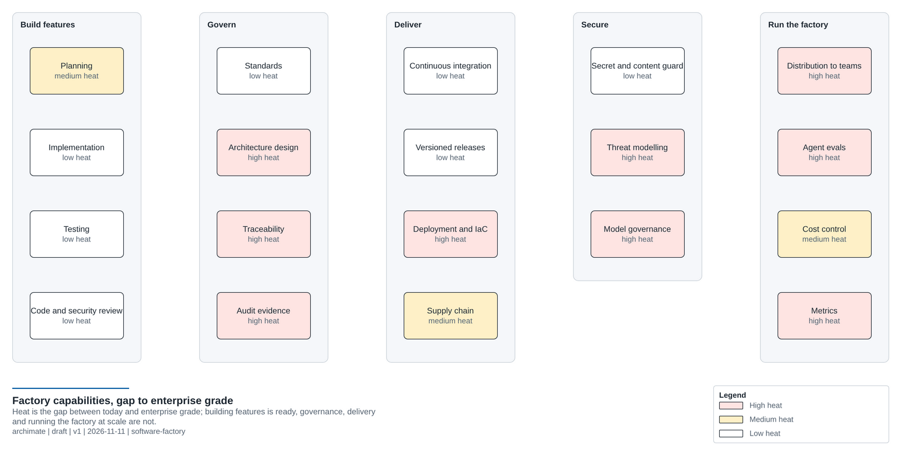
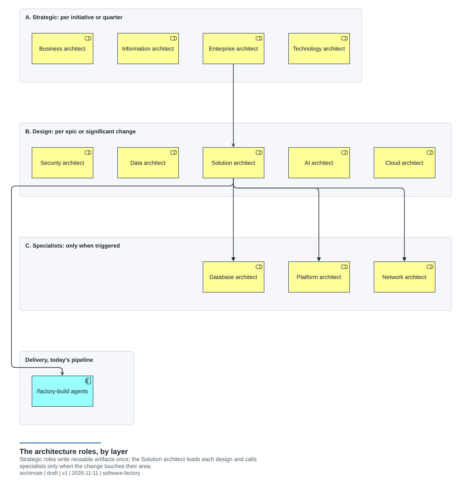
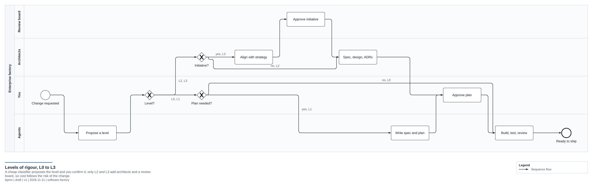
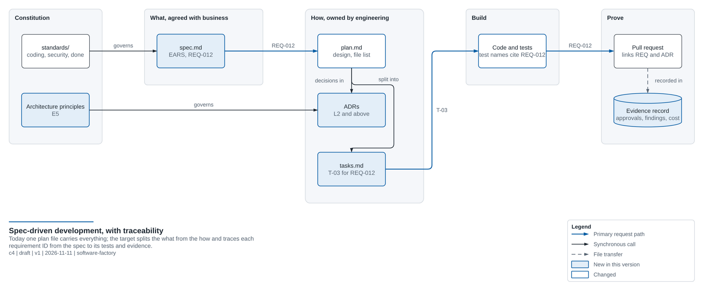
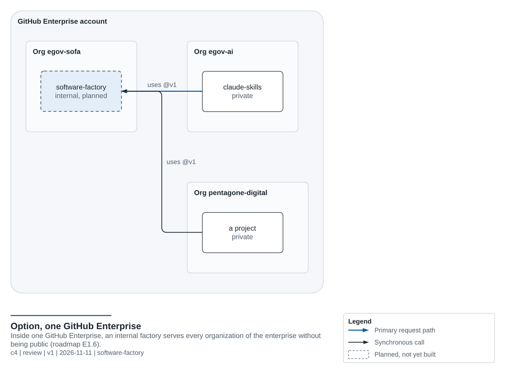

# Enterprise Vision: from personal factory to enterprise-grade software factory

**Status:** proposed, 2026-11-11. To be analysed again before any work starts. The work items are tracked as phases
E1 to E6 in [ROADMAP.md](ROADMAP.md#enterprise-track).

The factory started as a personal toolkit for one developer. The goal is that it becomes an **enterprise-grade
software factory**: used by teams, governed, auditable, with architecture built in, while it **stays cheap and fast
for personal use**.

**The rule that holds everything together: one factory, several levels of rigour.** A personal fix keeps today's
cost and speed. Enterprise rigour applies only where a change needs it. Cost always follows the risk of the change.

---

## 1. Where the factory is still personal

| Where | What is personal today | What an enterprise needs |
|---|---|---|
| `claude/CLAUDE.md` | An "About me" section ("I'm building my skills") | Organization standards, separate from personal preferences |
| `scripts/install.sh` | Copies files into each user's `~/.claude` | Central distribution: a plugin marketplace (roadmap I7) and Claude Code managed settings |
| `scripts/new-project.sh` | The owner is the logged-in GitHub user | An organization owner, a project catalog, naming rules |
| README and docs | "A personal factory", "my projects" | Product docs written for roles: platform team, project teams, architects |
| Repository governance | One maintainer; no CODEOWNERS, rulesets or required reviews | CODEOWNERS per area, protected `main`, release approvals |
| Hosting | A public repo in `egov-sofa`; claude-skills lives in another organization | A GitHub Enterprise account with **internal** repos, which share workflows across the enterprise's organizations (this also removes the cross-organization problem) |
| Evidence | Nothing records what the pipeline decided | An audit trail per run: spec, approvals, findings, model, cost |

The same gap, by capability. Heat is the distance from today to enterprise grade: building features is ready;
governance, delivery and running the factory at scale are not.

---

## 2. The architecture roles

Twelve architects running on every feature would be expensive and would overlap. They are split into three layers
by **when** they run.

### Layer A: strategic (per initiative or per quarter, never per feature)

These produce **reusable artifacts** once. Every other agent then reads them, so their cost is shared across all
later work.

| Architect | Owns | Artifacts | When it runs |
|---|---|---|---|
| **Business** | Capabilities, value streams, business rules, stakeholders | Capability map, business requirements, KPIs | Start of an initiative; feeds the spec |
| **Enterprise** | Alignment with strategy, the portfolio, architecture principles | Principles, reference architectures, ADR governance | Initiative approval; principles kept up to date |
| **Information** | The meaning of data: entities, glossary, classification, lineage | Canonical information model, data classification policy | When new business entities appear |
| **Technology** | Approved technologies and their lifecycle | Technology radar (adopt, trial, hold, retire), standard stacks | Quarterly; when a new technology is proposed |

### Layer B: design (per epic or significant change)

| Architect | Owns | Artifacts |
|---|---|---|
| **Solution** (lead) | End-to-end design of the change; coordinates the other architects | C4 context and container diagrams, ADRs, non-functional requirements, integration contracts |
| **Security** | Threat modelling at design time (the security auditor checks the code later) | STRIDE threat model, security requirements, identity and secrets design |
| **Data** | How data flows, is stored, retained and integrated | Data flows, retention and privacy design, events and pipelines |
| **AI** | Use of LLMs and machine learning | Model choice, eval plan, prompt-injection and data-leak controls, AI risk and cost (EU AI Act, ISO 42001 where relevant) |
| **Cloud** | Mapping the design onto cloud services | Service choice, landing-zone fit, cost estimate (FinOps), resilience and regions |

### Layer C: specialists (only when the plan touches their area)

| Architect | Runs when the plan... | Artifacts |
|---|---|---|
| **Database** | adds or changes a schema, queries or migrations | Schema design, index and migration plan, rollback |
| **Platform** | changes CI/CD, the runtime, containers or developer tooling | Golden-path compliance, platform contracts |
| **Network** | changes ingress, egress, private connectivity, DNS or firewalls | Network flows, segmentation, zero-trust check |

### Where the roles meet

- **Information** covers what data *means*, **Data** covers how it *flows*, **Database** covers how it is *stored*.
- **Technology** decides what is *allowed*, **Platform** decides what is *provided*, **Cloud** decides where it
  *runs*, **Network** decides how it *connects*.
- **Enterprise** sets the rules; **Solution** applies them to one change; **Business** says why the change matters.

---

## 3. Levels of rigour: how cost stays at personal level

A cheap classifier step (a Haiku call) reads the request and proposes a level. The person can always override it.

| Level | For | Pipeline | Approximate cost |
|---|---|---|---|
| **L0** fix | A typo, a small bug | implement, test, review | lower than today |
| **L1** feature | Today's `/factory-build`; **the personal default** | plan, approve, build, test, review and security, docs | same as today |
| **L2** significant change | A new component, new data, a new external integration | L1 plus a **design gate**: Solution and Security architects, the specialists the plan triggers, an ADR | 2 to 4 more agent runs |
| **L3** initiative | A new system or product | Business, then Enterprise alignment, then a Solution-led design with every relevant architect, then an **architecture review board** where a human approves; then L2 for each epic | paid once per initiative |

**Cost controls:**
- **Profiles.** Each project has a `factory.yaml` with a profile (`personal`, `team` or `enterprise`), the highest
  level allowed, the models to use and a **budget cap per run**.
- **Model tiers.** Haiku for classification and triggers, Sonnet for specialists, Opus only for the Solution and
  Security architects and the final review.
- **Reuse.** Strategic architects write artifacts that are cached and reused, never regenerated on every run.
- **Personal stays personal.** In the `personal` profile, L2 and L3 are opt-in. Today's workflow and cost do not
  change.

---

## 4. Spec-driven development at enterprise grade

**Today:** the factory is spec-first but uses no framework. The planner writes `docs/plans/<date>-<slug>.md` with a
goal, testable acceptance criteria, a design, the files to change and a test plan. A person approves it before any
code is written. The tester and reviewer check the acceptance criteria. No marker of GitHub Spec Kit, Kiro, BMAD,
OpenSpec or Tessl is present.

**What an enterprise needs that is missing:**
- **Living specs:** a description of the system that is kept current, not only one plan per change.
- **Numbered requirements** (`REQ-012`), **traced** to tests, code, ADRs and pull requests.
- A **constitution:** the organization's standards and principles, which every agent applies.
- A **task breakdown**, so large work can be split, reviewed and done in parallel.
- **The spec separated from the plan:** business and architecture agree the *what*; engineering owns the *how*.

| Option | Fit for the enterprise goal |
|---|---|
| **GitHub Spec Kit** | Its constitution, spec, plan and tasks map directly onto the needs above; widely known; works with any agent. It has no architect roles, so the factory adds those. |
| **BMAD Method** | Has persona agents, including an architect and a product manager, so it is the closest to the roster above. Heavy and opinionated, and harder to tune for cost. |
| **Kiro-style** (`requirements.md` in EARS format, `design.md`, `tasks.md`) | A clean structure, but tied to its own tool. Its EARS requirement format is worth borrowing. |
| **Custom only** | Full control, but nobody outside will recognize it. |

**Recommendation:** a file layout **compatible with Spec Kit**, run by the factory's own agents:
- `standards/` becomes the constitution.
- `spec.md` holds the requirements, written in EARS format with IDs.
- `plan.md` holds the design, with the architects' sign-offs and ADRs.
- `tasks.md` holds the task breakdown.

People who know Spec Kit recognize the format, and the factory takes no hard dependency on another tool.

---

## 5. Enterprise needs beyond the architects

In order of priority:

1. **Governance and audit.** Every run writes an evidence record (spec, approvals, findings, model, cost). Gates are
   enforced in CI as code, for example "an ADR is required at L2 and above". This is what auditors and ISO 27001 or
   SOC 2 need.
2. **Evals (roadmap I1) become essential.** Teams cannot rely on agents whose quality nobody measures.
3. **Software supply chain.** SBOMs, signed releases with provenance (SLSA), dependency review, licence policy.
4. **Delivery: CD and infrastructure as code.** Terraform or Bicep templates, environments with approvals, a landing
   zone. These give the Cloud and Platform architects something concrete to check against.
5. **Model governance.** An approved model list, data residency (Amazon Bedrock, Google Vertex AI or zero-retention
   options), cost reporting.
6. **Central distribution.** A plugin marketplace and managed settings, so fifty developers run the same factory
   version.
7. **Metrics.** DORA metrics, cost per feature, eval scores, and how often a gate catches a real issue.

What the target looks like once E1 to E6 are in place:

---

## 6. Phases

The phases are listed with their work items in [ROADMAP.md](ROADMAP.md#enterprise-track).

| Phase | Content | Why in this order |
|---|---|---|
| **E1 Foundations** | Separate personal from organization setup, profiles and `factory.yaml`, rulesets and CODEOWNERS, plugin distribution, evidence records | Everything else builds on these |
| **E2 Spec-driven upgrade** | Spec Kit-compatible spec, plan and tasks; requirement IDs; traceability; the classifier and the levels | The architects need a spec to work against |
| **E3 Design gate** | Solution and Security architects, ADRs, threat model, an architecture repository | The most value for the cost |
| **E4 Specialists** | Data, Database, AI, Cloud, Platform and Network architects, each with its trigger | They run only when relevant, so cost stays low |
| **E5 Strategic layer** | Business, Enterprise, Information and Technology architects writing the principles, capability map, information model and technology radar | They need the E3 and E4 artifacts to govern |
| **E6 Delivery and trust** | Evals, supply chain, CD and infrastructure-as-code templates, metrics | Proves to the business that the factory is safe to scale |

---

## 7. Open questions for the next analysis

These need an answer before E1 starts:

1. **Hosting.** Stay public in `egov-sofa`, or move to a GitHub Enterprise account with internal repos? This decides
   how claude-skills and future teams reach the factory. Today and the private case are drawn in
   [SHARED-SERVICES.md](SHARED-SERVICES.md#who-can-call-the-factory); the enterprise option:

   
2. **Spec format.** Confirm the Spec Kit-compatible layout, or choose another option from section 4.
3. **Default profile.** Should new projects start as `personal` or `team`? Who may raise a project to `enterprise`?
4. **Architecture repository.** One shared repo for principles, ADRs and the technology radar, or a folder in each
   project?
5. **Human gates.** Who approves at the L2 design gate and the L3 architecture review board? A RACI is needed.
6. **Model and data policy.** Which models and providers are allowed, and which data may an agent see?
7. **Budget.** Default cost cap per run and per month for each profile.
8. **Compliance targets.** Which frameworks the evidence records must serve: ISO 27001, SOC 2, the EU AI Act,
   others?
