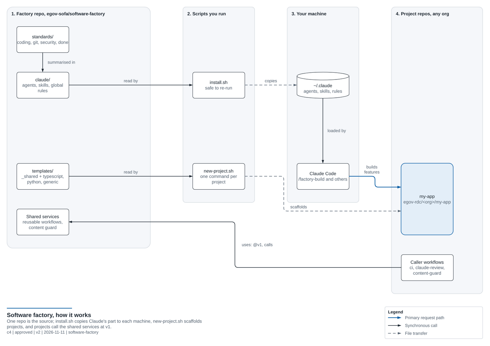

# Getting Started (beginner friendly)

This guide walks you through using the factory for the first time. Every step says **what** to do and **why**.

---

## Step 0: Understand the idea in one minute

Building software well means repeating the same steps every time:

1. **Plan** what to build
2. **Build** it
3. **Test** that it works
4. **Review** it for bugs and security holes
5. **Document** it
6. **Ship** it (save it to GitHub and let automated checks run)

People skip steps when they're in a hurry. A *factory* makes the steps automatic and identical every time. Here the workers are AI agents in Claude Code, and the conveyor belt is GitHub Actions.



The steps below follow this picture from left to right: install (step 1), create a project (step 2), build a feature
(step 3).

---

## Step 1: Install the factory into Claude Code

Open **Git Bash** (or the Claude Code terminal) and run:

```bash
bash /c/DEV/PROJECTS/gitHub/egov-rdc/egov-sofa/software-factory/scripts/install.sh
```

**What this does:**
- Copies the AI agents into `~/.claude/agents/`. Claude Code reads that folder at startup, so the agents become available **in every project**.
- Copies the slash commands (skills) into `~/.claude/skills/`.
- Copies the global rules into `~/.claude/CLAUDE.md`. Claude reads this file at the start of **every** conversation, which is how it learns your standards.
- If you already have a `CLAUDE.md`, it saves a backup first. Nothing is lost.

**Restart Claude Code** after installing so it picks up the new files.

> 💡 Whenever you change something in `/c/DEV/PROJECTS/gitHub/egov-rdc/egov-sofa/software-factory/claude/`, run `install.sh` again to update your installed copy.

---

## Step 2: Create your first project

```bash
bash /c/DEV/PROJECTS/gitHub/egov-rdc/egov-sofa/software-factory/scripts/new-project.sh hello-factory typescript --owner egov-sofa
```

**What this does:**
1. Creates `/c/DEV/PROJECTS/gitHub/egov-rdc/egov-sofa/hello-factory/` (folders mirror GitHub: `egov-rdc/<org>/<project>`; `--owner` picks the org, and the script always asks for it)
2. Copies in the shared files (editor settings, PR template, Dependabot config, CLAUDE.md)
3. Adds the TypeScript-specific files on top (package.json, tsconfig, a sample function and test)
4. Fills in placeholders such as the project name and your GitHub username
5. Runs `git init` and makes the first commit

**Optional:** add `--github private` (or `public`) to also create the GitHub repository and push to it:

```bash
bash /c/DEV/PROJECTS/gitHub/egov-rdc/egov-sofa/software-factory/scripts/new-project.sh hello-factory typescript --owner egov-sofa --github private
```

Then install dependencies and check that everything passes:

```bash
cd /c/DEV/PROJECTS/gitHub/egov-rdc/egov-sofa/hello-factory
npm install
npm test
```

---

## Step 3: Build a feature with the AI team

```bash
cd /c/DEV/PROJECTS/gitHub/egov-rdc/egov-sofa/hello-factory
claude
```

Inside Claude Code, type:

```
/factory-build add a function that checks whether a string is a palindrome
```

**What you will see:**

| Stage | Who | What you do |
|---|---|---|
| 1. Plan | 🧭 `planner` agent | Read the plan saved in `docs/plans/`. **Approve it or ask for changes.** This is your most important job. |
| 2. Build | 🔨 `implementer` agent | Nothing. Watch if you like. |
| 3. Test | 🧪 `tester` agent | Nothing. It runs and adds tests. |
| 4. Review | 🔍 `reviewer` + 🛡️ `security-auditor` (in parallel) | Nothing. They report problems. |
| 5. Fix | 🔨 `implementer` | Nothing. It fixes what the reviewers found (up to 2 rounds). |
| 6. Docs | 📝 `docs-writer` | Nothing. |
| 7. Summary | Claude | Read the summary. Try the feature yourself. |

All work happens on a new **branch** (a safe copy of your code), so your main code is never touched until you decide.

---

## Step 4: Ship it

```
/factory-ship
```

Claude commits the work, pushes the branch to GitHub, and opens a **Pull Request** (PR). GitHub Actions then runs the CI pipeline (lint, build, test) automatically. When it's green ✅, merge the PR on GitHub.

---

## Step 5: Use it on an existing project

Go into any existing project folder, start `claude`, and run:

```
/factory-onboard
```

Claude detects the language and adds a `CLAUDE.md`, a CI workflow and a PR template, then shows you what changed before committing anything.

---

## Daily cheat sheet

```
New project         →  /factory-new   (or scripts/new-project.sh)
Build a feature     →  /factory-build <what you want>
Check my changes    →  /factory-review
Save and open a PR  →  /factory-ship
Existing project    →  /factory-onboard
```

## Troubleshooting

| Problem | Fix |
|---|---|
| `/factory-build` isn't recognized | Run `install.sh`, then restart Claude Code |
| CI fails with "workflow was not found" | The factory has no `v1` tag yet (tag a release: see [SHARED-SERVICES.md](SHARED-SERVICES.md#versioning-and-releases-of-the-factory)), your project's Actions permissions block other orgs' workflows, or the factory repo is private and the project is in another org. See [CUSTOMIZING.md](CUSTOMIZING.md#why-the-factory-repo-is-public) |
| `gh: command not found` | Install the GitHub CLI from https://cli.github.com and run `gh auth login` |
| The plan is wrong | Say what's wrong. The planner revises it before any code is written |
