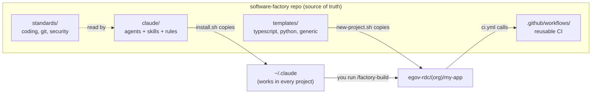
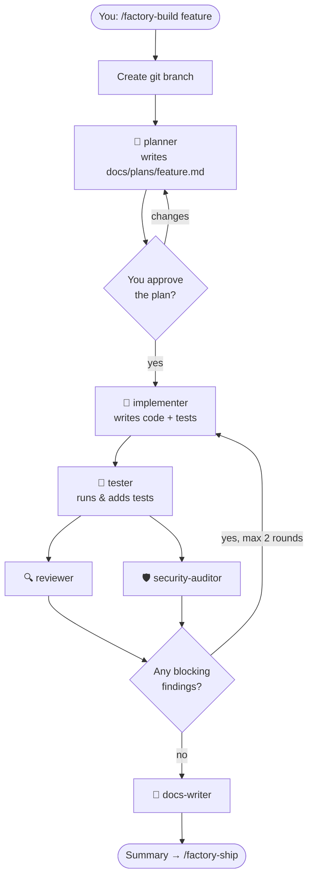

# How It Works

## The big picture



**Why this design?**
- **One source of truth.** Everything lives in one git repo. Improve an agent or a CI step once, and every project benefits.
- **Copy for Claude, reference for CI.** Claude Code needs files on disk (`~/.claude`), so we *copy* them. GitHub Actions can *reference* workflows from another repo, so projects *call* the shared workflow instead of duplicating it.

---

## Part 1: The AI agent pipeline

An **agent** (also called a *subagent*) is Claude running with a focused job, its own instructions, and a limited set of tools. Splitting the work across specialists works better than one giant prompt because:

- each agent starts with a **fresh, focused context** and isn't distracted by earlier work
- read-only agents (reviewer, security) **can't accidentally change code**
- reviewers **didn't write the code**, so they look at it with fresh eyes



| Agent | Can edit code? | Model | Job |
|---|---|---|---|
| `planner` | Writes the plan file only | opus | Turns a vague request into a concrete plan with acceptance criteria |
| `implementer` | ✅ | inherits | Writes code that follows the plan and project conventions |
| `tester` | ✅ (tests only) | inherits | Runs the suite, adds missing tests, reports results |
| `reviewer` | ❌ read-only | opus | Finds bugs, checks the plan was followed |
| `security-auditor` | ❌ read-only | opus | Finds vulnerabilities and leaked secrets |
| `docs-writer` | ✅ (docs only) | sonnet | Updates README and CHANGELOG |

The **skills** (`/factory-build`, etc.) are the *conductors*: instructions that tell the main Claude session which agents to call, in what order, and what to do with their results.

---

## Part 2: Project scaffolding

`new-project.sh` builds a project in **layers**:

```
templates/_shared/     ← every project gets these (CLAUDE.md, .editorconfig, PR template, dependabot)
        +
templates/typescript/  ← language-specific files, copied on top (can override _shared files)
        =
/c/DEV/PROJECTS/gitHub/egov-rdc/<org>/my-app/
```

Then it replaces placeholders:

| Placeholder | Becomes |
|---|---|
| `{{PROJECT_NAME}}` | `my-app` |
| `{{PACKAGE_NAME}}` | `my_app` (for Python imports) |
| `{{GITHUB_OWNER}}` | owner of the new project's GitHub repo |
| `{{FACTORY_REPO}}` | where the shared CI lives, read from the factory's git remote (`egov-sofa/software-factory`) |
| `{{YEAR}}` | current year |

---

## Part 3: CI/CD

**CI** (Continuous Integration) means that every time you push code, a computer in the cloud checks it automatically.

Each project has a tiny `.github/workflows/ci.yml`:

```yaml
jobs:
  ci:
    uses: YOUR_NAME/software-factory/.github/workflows/reusable-node.yml@v1
```

That one line runs the full pipeline defined in the factory repo:

```
checkout → install runtime → install deps (cached) → lint → build → test
```

The factory also has its own **self-test** workflow ([factory-selftest.yml](../.github/workflows/factory-selftest.yml)). On every change to the factory, it creates a project from each template and runs its tests. If you break a template, you find out immediately. It also checks the frontmatter of every agent and skill (`scripts/validate.py`) and runs the tests in `scripts/tests/`, which exercise `install.sh`, `uninstall.sh` and the options of `new-project.sh` in temporary folders.

**Why `@v1` and not `@main`?** A project follows the factory's releases, not every commit. `v1` is a tag that the
[Release workflow](../.github/workflows/release.yml) moves to each compatible release; a breaking change becomes `v2`,
and each project moves when you choose. So a bad commit on the factory's `main` breaks nothing until it is released.

Besides CI, every new project calls three more **shared services** the same way (details in
[SHARED-SERVICES.md](SHARED-SERVICES.md)):

| Service | When it runs | What it does |
|---|---|---|
| Claude review | every pull request (once turned on) | Claude reviews the change against the project's `.claude/skills/pr-review/SKILL.md` and comments |
| Claude on demand | a PR comment starting with `@claude` | Answers the question or re-reviews the part named |
| Content guard | every pull request, and before each commit (git hooks) | Blocks secrets, public IP addresses, internal host names and a private denylist |

**CD** (Continuous Deployment) depends on where you deploy (Vercel, AWS, Azure…), so it isn't hard-wired. See [CUSTOMIZING.md](CUSTOMIZING.md#adding-deployment-cd) for how to add it.

---

## Part 4: Shared standards

The files in [`standards/`](../standards/) are written for **both humans and AI**:

- The global `~/.claude/CLAUDE.md` summarizes them, so Claude follows them in every session
- The agents are told to read them, for example the reviewer checks against `DEFINITION-OF-DONE.md`
- Each project's `CLAUDE.md` adds project-specific details (commands, folder layout)

```
~/.claude/CLAUDE.md          ← global: "how I work everywhere"
  └─ project/CLAUDE.md       ← local: "how this project works" (wins if they conflict)
```
