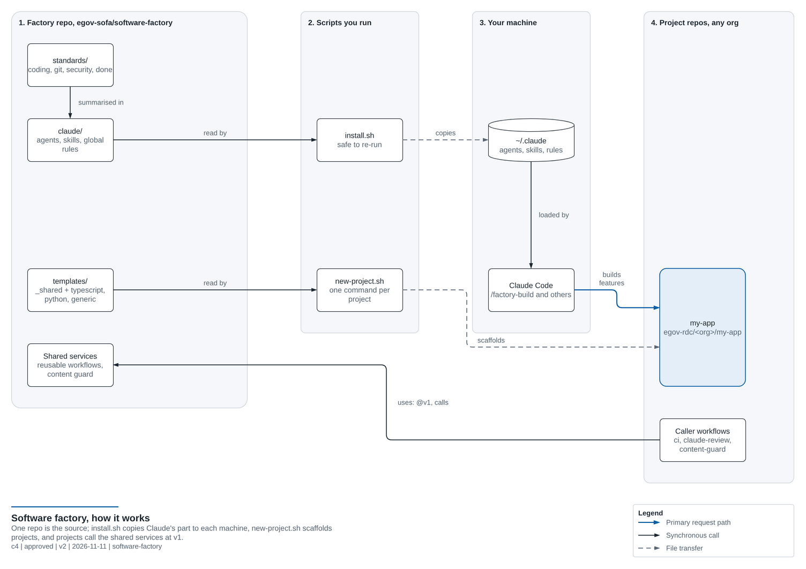
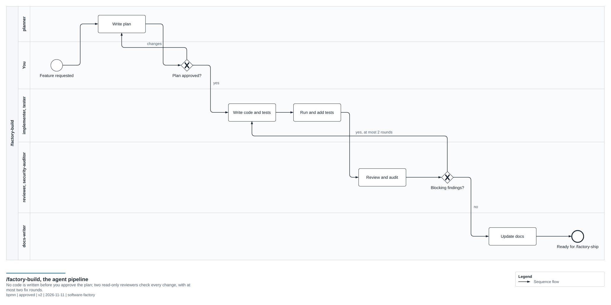
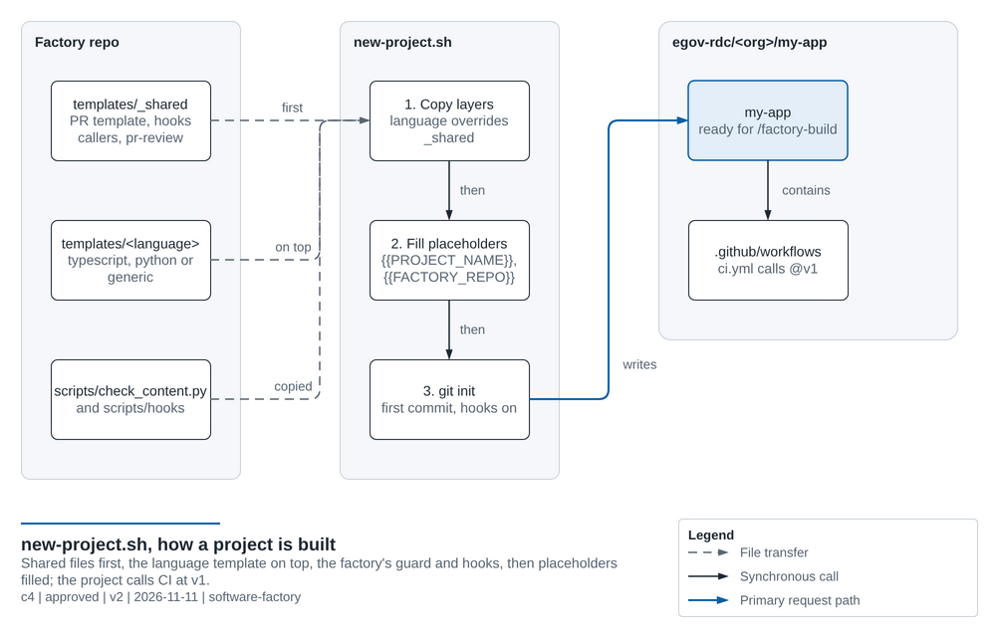
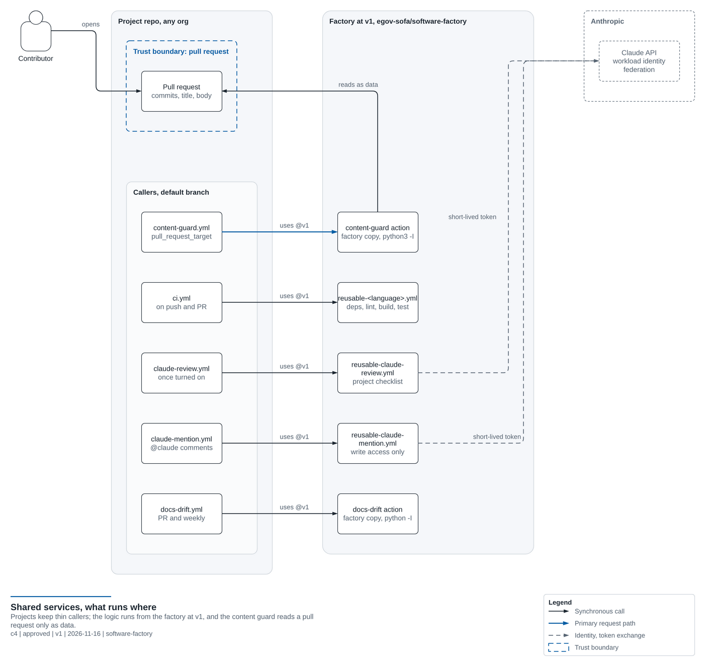
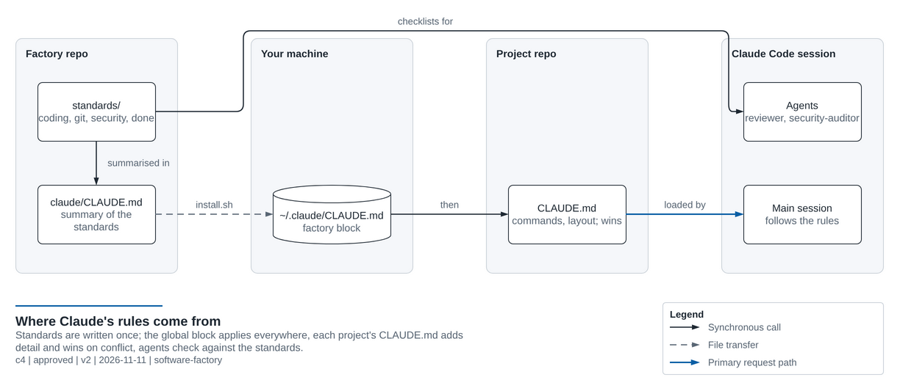

# How It Works

## The big picture



*Diagrams in these docs are generated from YAML sketches in [`diagrams/`](diagrams/) by the architecture-diagram
skill of claude-skills; see [diagrams/README.md](diagrams/README.md) to change one.*

**Why this design?**
- **One source of truth.** Everything lives in one git repo. Improve an agent or a CI step once, and every project benefits.
- **Copy for Claude, reference for CI.** Claude Code needs files on disk (`~/.claude`), so we *copy* them. GitHub Actions can *reference* workflows from another repo, so projects *call* the shared workflow instead of duplicating it.
- **Projects follow releases, not commits.** They call the factory at `@v1`, a tag that moves only when a release is made (Part 3).

---

## Part 1: The AI agent pipeline

An **agent** (also called a *subagent*) is Claude running with a focused job, its own instructions, and a limited set of tools. Splitting the work across specialists works better than one giant prompt because:

- each agent starts with a **fresh, focused context** and isn't distracted by earlier work
- read-only agents (reviewer, security) **can't change code**: they have no tool that writes or runs commands
- reviewers **didn't write the code**, so they look at it with fresh eyes



Before the plan, the conductor creates a branch (`feat/…` or `fix/…`); after each stage it commits, so every stage has
a checkpoint to return to. The reviewer and the security auditor run **in parallel** on the same change.

| Agent | Can edit code? | Model | Job |
|---|---|---|---|
| `planner` | Writes in `docs/plans/` only (enforced) | opus | Turns a vague request into a concrete plan with acceptance criteria |
| `implementer` | ✅ | inherits | Writes code that follows the plan and project conventions |
| `tester` | ✅ (test files only, enforced) | inherits | Runs the suite, adds missing tests, reports results |
| `reviewer` | ❌ read-only | opus | Finds bugs, checks the plan was followed |
| `security-auditor` | ❌ read-only | opus | Finds vulnerabilities and leaked secrets |
| `docs-writer` | ✅ (docs only, enforced) | sonnet | Updates README and CHANGELOG |

**What is enforced, and what is only asked.** A rule in a prompt depends on the model following it; the ones that
matter most are also enforced:

- The reviewer and security auditor have only Read, Grep and Glob. The conductor writes what they need (the diff,
  the changed files, test and audit results) to `.git/factory-review/` before calling them.
- The planner, tester, docs-writer and implementer carry a hook ([agent_guard.py](../claude/hooks/agent_guard.py))
  that refuses an edit outside their paths (none for the implementer) and any git command that is not a known read
  (`status`, `diff`, `log`, …): the conductor does all git work. The refusal tells the agent why, so it can report instead.
- The git check reads the command as written. It catches git typed directly, also behind wrappers, `bash -c`,
  `eval`, backticks and aliases, but not git whose name is assembled at run time (`G=git; $G push`) or started by
  another program (a Python script calling git). It stops mistakes and casual prompt injection; it is not a
  security boundary.
- Still only asked: what an agent does with Bash beyond git (a script could write a file), and everything in the
  main conversation. The `protect-main` ruleset on GitHub remains the boundary for `main`.

**Pipeline state, so a run can resume.** Once you approve the plan, `/factory-build` writes four lines under its
`**Status:**` (`Stage`, the next stage to run; `Round`, fix rounds done; `Base`; `Branch`) and updates them in the
commit that closes each stage. Each review is logged at the end of the plan under `## Review rounds`, one table per
round with an ID per finding (`REV-1.1`, `SEC-1.1`, `TEST-1.1`) and the implementer's answer (`fixed: …` or
`disagree: …`). So:

- `/factory-build --resume` continues an interrupted run from the plan, even in a new session.
- Re-reviews read the earlier findings and judge the answers. From round 2 they raise new findings on unchanged code
  only when they are BLOCKER or CRITICAL, so the target stops moving; a finding still disputed goes to you to decide.
- Every agent's report starts with fixed lines (`Verdict:`, `Blocking:`, `Result:` …) that
  [factory_state.py](../scripts/factory_state.py) checks. The conductor gates on those values, not on its reading of
  the prose, and sends a malformed report back once.
- The base branch is detected once and given to every agent, so a repository whose base is `master` works too.

The **skills** (`/factory-build`, etc.) are the *conductors*: instructions that tell the main Claude session which agents to call, in what order, and what to do with their results.

---

## Part 2: Project scaffolding

`new-project.sh` builds a project in **layers**: `templates/_shared/` first (every project gets these), then the
language template on top (it can override a shared file), then the factory's content guard and its git hooks.



The project lands in `<workspace>/<org>/my-app/`, next to the factory's own org folder (for example
`/c/DEV/PROJECTS/gitHub/egov-rdc/<org>/my-app/`).

Then it replaces placeholders:

| Placeholder | Becomes |
|---|---|
| `{{PROJECT_NAME}}` | `my-app` |
| `{{PACKAGE_NAME}}` | `my_app` (for Python imports) |
| `{{GITHUB_OWNER}}` | owner of the new project's GitHub repo |
| `{{FACTORY_REPO}}` | where the shared CI lives, read from the factory's git remote (`egov-sofa/software-factory`) |
| `{{YEAR}}` | current year |

Last, it ships the factory's standards into `.factory/standards/`, marks the files the factory owns (the content
guard, its hooks, the standards) with a "Managed by software-factory" header, and writes `.factory/answers.yml`: the
factory commit and release it rendered from, and the answers above. With them, `/factory-update` can later render the
same project from the old and the new factory release and bring the project forward: it replaces the managed files,
merges the workflows and config files with the project's own edits, and leaves the project's own files alone (see
"Updating the files copied into a project" in [SHARED-SERVICES.md](SHARED-SERVICES.md)).

---

## Part 3: CI/CD

**CI** (Continuous Integration) means that every time you push code, a computer in the cloud checks it automatically.

Each project has a tiny `.github/workflows/ci.yml`:

```yaml
jobs:
  ci:
    uses: egov-sofa/software-factory/.github/workflows/reusable-node.yml@v1
```

That one line runs the full pipeline defined in the factory repo: checkout, install the runtime, install
dependencies (cached), lint, build, test, and an audit of production dependencies (Node always; Python with `package-manager: uv`, which
also adds a type check and a build).

The factory also has its own **self-test** workflow ([factory-selftest.yml](../.github/workflows/factory-selftest.yml)). On every change to the factory, it creates a project from each template and runs that stack's commands from [`templates/stacks.toml`](../templates/stacks.toml): on Linux for a pull request, and on Linux, macOS and Windows on `main`, every week and on demand. It also runs the **real shared workflows** (`reusable-*.yml`) on the committed fixture projects in `tests/fixtures/`, and the content-guard action on the pull request itself, so a broken shared service is found here before a release moves `v1`, not by the projects after. It also checks the frontmatter of every agent and skill (`scripts/validate.py`) and runs the tests in `scripts/tests/`, which exercise `install.sh`, `uninstall.sh` and the options of `new-project.sh` in temporary folders.

**Why `@v1` and not `@main`?** A project follows the factory's releases, not every commit. `v1` is a tag that the
[Release workflow](../.github/workflows/release.yml) moves to each compatible release; a breaking change becomes `v2`,
and each project moves when you choose. So a bad commit on the factory's `main` breaks nothing until it is released.

Besides CI, every new project calls three more **shared services** the same way (details in
[SHARED-SERVICES.md](SHARED-SERVICES.md)):



| Service | When it runs | What it does |
|---|---|---|
| Claude review | every pull request (once turned on, see [CLAUDE-SERVICES-AUTH.md](CLAUDE-SERVICES-AUTH.md)) | Claude reviews the change against the project's `.claude/skills/pr-review/SKILL.md` and comments |
| Claude on demand | a PR comment starting with `@claude` | Answers the question or re-reviews the part named |
| Content guard | every pull request, and before each commit (git hooks) | Blocks secrets, public IP addresses, internal host names and a private denylist |

**CD** (Continuous Deployment) depends on where you deploy (Vercel, AWS, Azure…), so it isn't hard-wired. See [CUSTOMIZING.md](CUSTOMIZING.md#adding-deployment-cd) for how to add it.

---

## Part 4: Shared standards

The files in [`standards/`](../standards/) are written for **both humans and AI**:

- The global `~/.claude/CLAUDE.md` summarizes them, so Claude follows them in every session
- The agents are told to read them, for example the reviewer checks against `DEFINITION-OF-DONE.md`
- Each project carries a copy in `.factory/standards/`, so they travel with it: its `AGENTS.md` lists them in a block
  between `software-factory:standards` markers, the agents read the project's copy first, and the Claude review in CI
  reads the copy on the pull request's base branch (a pull request cannot weaken the rules it is reviewed against).
  `/factory-update` keeps the copy and the block current
- Each project's `AGENTS.md` adds project-specific details (commands, folder layout). Claude Code reads it through
  the project's `CLAUDE.md` (`@AGENTS.md`); GitHub Copilot, Codex and Cursor read it directly



The diagram still names the project's file `CLAUDE.md`; since I28 the instructions are in `AGENTS.md`, which `CLAUDE.md`
imports. It is redrawn with the next diagram update (roadmap I15).

The global block says how to work everywhere; a project's `AGENTS.md` says how this project works, and wins where the
two conflict.
