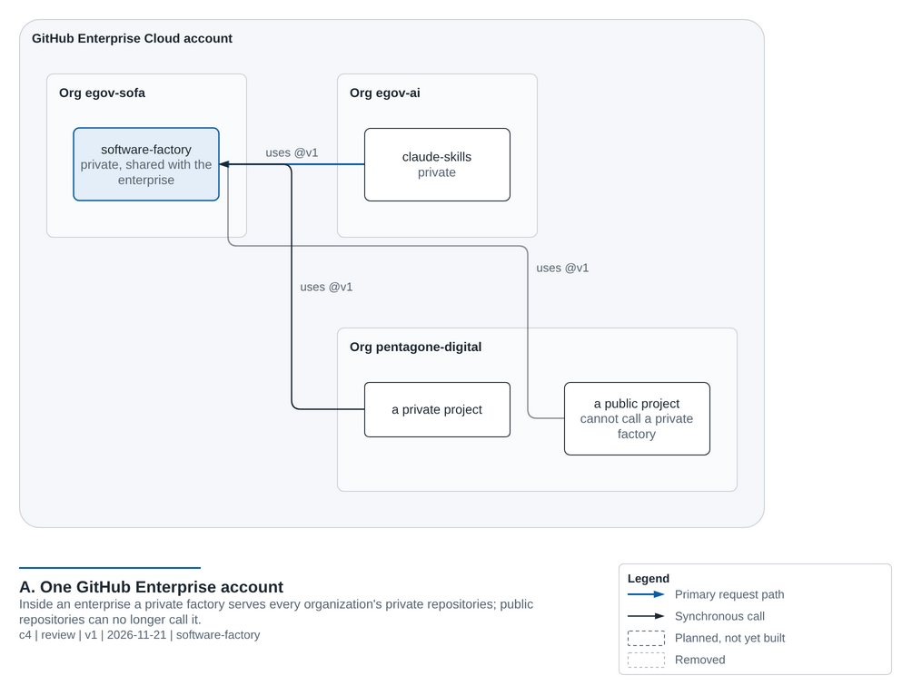
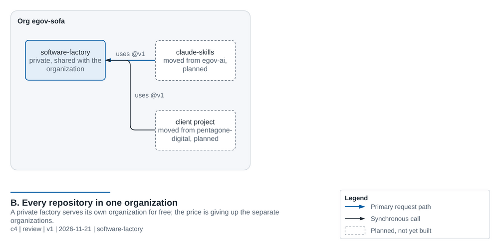

# A private factory for several organizations

**Status:** analysis, 2026-11-21. No decision yet; it answers open question 1 of
[ENTERPRISE-VISION.md](ENTERPRISE-VISION.md#7-open-questions-for-the-next-analysis) and roadmap item E1.6.

**Question:** can the factory become private while projects in the other organizations (`egov-ai`,
`egov-infra`, …) keep using it? The same person owns every one of these organizations.

**Short answer:** not as things are wired today. GitHub decides by the **owner of the repository**, not by the person
who owns the organizations: a private repository shares its workflows and actions with its own organization only,
or with every organization of one **GitHub Enterprise** account. So either the boundary changes (options A and B), or
projects stop calling the factory across it (options C, D and E).

---

## What GitHub allows

From GitHub's documentation (read 2026-11-21 from the `github/docs` repository,
`content/actions/how-tos/reuse-automations/` and `content/actions/reference/workflows-and-actions/reusing-workflow-configurations.md`):

| The private factory is owned by | Its access setting | Who can call its workflows and actions |
|---|---|---|
| a personal account | "Accessible from repositories owned by 'USERNAME' user" | that user's own repositories, not the organizations the user owns |
| an organization | "Accessible from repositories in the 'ORGANIZATION-NAME' organization" | repositories of that organization only |
| an organization owned by an enterprise account | allows workflows in other internal or private repositories | "repositories owned by the same organization, or by any organization owned by the enterprise" |

Three rules of the enterprise case matter here:

- **Both internal and private factories can be shared.** GitHub: "Any actions or reusable workflows stored in the
  internal or private repository can be used in workflows defined in other internal or private repositories owned by
  the same organization, or by any organization owned by the enterprise."
- **But they serve different callers.** "Actions and reusable workflows stored in internal repositories cannot be used
  in public repositories and actions and reusable workflows stored in private repositories cannot be used in public or
  internal repositories." So:

  | Factory | Private projects | Internal projects | Public projects |
  |---|---|---|---|
  | internal | yes | yes | no |
  | private | yes | **no** | no |

  A private factory is the stricter choice, but a project made `internal` (a usual default for shared code in an
  enterprise) can no longer call it: its run fails with "workflow was not found".
- **Public repositories lose access** in any option that keeps the factory non-public and calls it directly.

**Price.** GitHub's pricing page (2026-11-21): Enterprise **$21 per user / month**, Team $4. It includes an
"Enterprise Account to centrally manage multiple organizations".

**How people are counted** (GitHub's billing documentation, read 2026-11-21 from `github/docs`:
`content/billing/reference/github-license-users.md`, `data/reusables/enterprise-licensing/unique-user-licensing-model.md`,
`data/reusables/billing/metered-license-measures.md`):

- **Once per person, across the whole enterprise.** "Each user only consumes one license, no matter how many [GitHub
  Enterprise Server] instances the user uses, or how many organizations the user is a member of." You alone, owner of
  `egov-sofa`, `egov-ai`, `egov-infra` and the others, are **one license: $21 a month, $252 a year**, not one per
  organization. Each other person who is a member of any organization adds one.
- **Who is billed:** organization members and owners; enterprise owners who are a member of at least one of its
  organizations; outside collaborators on private or internal repositories (each counted once, however many
  repositories); dormant members.
- **Who is not:** enterprise owners who belong to no organization, billing managers, outside collaborators on public
  repositories, people added to the enterprise but to none of its organizations. GitHub Apps (the docs-drift and update
  jobs' tokens) are not user accounts, so they take no license; a "machine user" account would.
- **Usage-based billing:** each month you pay for the distinct people who held a license at some point that month,
  pro rata from the day they started. Pending invitations take no license.
- **The Team plan goes away** for an organization that joins: it is billed through the enterprise, so `egov-infra`
  would not pay $4 and $21 for the same person.

**Trial.** A 30-day trial needs no payment method and gives up to 50 licenses. Existing organizations can be
transferred into it, and their own billing is paused during the trial. Two limits: an organization with a GitHub
Marketplace app installed (free or paid) cannot be transferred, and organizations created during the trial cannot
leave the enterprise until it is bought. A trial is enough to test option A with real projects before paying
(`content/admin/overview/setting-up-a-trial-of-github-enterprise-cloud.md`).

### True of every private option

- **The weekly update job needs a token.** `factory-update` clones the factory without credentials
  (`scripts/factory_update_job.py`, step `prepare`). A private factory needs a read token: the pattern that already
  works is the docs-drift job's **GitHub App, one installation per owner**, used through
  `actions/create-github-app-token`. Being allowed to *call* a workflow does not let a job *clone* the repository.
- **People need read access** to install the agents and skills (`install.sh`, or a plugin marketplace).
- **The docs change.** SHARED-SERVICES.md and CUSTOMIZING.md say the factory is public; templates use
  `{{FACTORY_REPO}}`, read from the factory's git remote, so new projects follow whatever repository they were made
  from.
- **Unchanged:** the Claude services' federation rules (they match the calling repository), the content guard's
  logic, and the release flow.

---

## The options

### A. One GitHub Enterprise account

Create an enterprise account, invite the organizations into it, set the factory's access to the enterprise. Calls stay
`egov-sofa/software-factory/…@v1`: **no change in any project**.

**Internal or private factory?** Make it **internal** if any project is or may become internal: it serves internal and
private projects, and its content is visible to the enterprise's members only, never to the public. Keep it **private**
only if every calling project stays private.

- **For:** the native answer; nothing to build or keep in sync. The enterprise also brings what E1 needs anyway:
  rulesets and policies for every organization, the audit log, single sign-on.
- **Against:** $21 per person per month, counted once across all organizations (you alone: $252 a year). Public
  repositories can no longer call the factory, nor internal ones if the factory is private; a public project would keep its own copy of the workflows (option E for
  that project only).
- **Effort:** S. Settings plus the update job's App token.

### B. Every repository in one organization

Transfer the repositories into `egov-sofa` (GitHub redirects the old URLs), set access to the organization.

- **For:** free; no new machinery.
- **Against:** gives up separate organizations: separate members, billing, settings and secrets per client or
  activity. It also contradicts claude-skills' exit plan, which keeps work skills movable to another organization.
- **Effort:** S per repository, but federation rules and Terraform must follow each transfer (the OIDC subject
  carries the owner ID).

### C. A public engine and a private factory

Split the repository by what must be secret. A small **public `factory-engine`** keeps the reusable workflows,
actions and their scripts: generic code with nothing about the organizations or clients in it, already checked by the
content guard. The **private `software-factory`** keeps the standards, agents, skills, templates, plans and roadmap.
Projects call the engine as today; the managed files (standards, hooks, the `AGENTS.md` block) still arrive through
the weekly update pull request, which reads the private factory with the App token.

- **For:** free; every organization and public repositories keep working; only what needs secrecy is secret.
- **Against:** two repositories and two release lines to keep in step; a one-time move of the workflows and a
  `uses:` change in every project (one update pull request).
- **Effort:** M.

### D. A private copy in each organization

On each release, the factory's Release workflow (with a GitHub App installed in every organization) pushes the new
tags into a private, read-only `software-factory` in each organization. A project calls its own organization's copy,
which GitHub allows.

- **For:** free; no project loses access; each organization can be audited on its own.
- **Against:** one copy per organization to create, protect and keep current; a failed push leaves one organization
  behind; projects of different organizations name different repositories (`{{FACTORY_REPO}}` already supports this).
- **Effort:** M.

### E. Workflows copied into each project

Projects stop calling the factory. The update job, which already copies managed files, also copies the workflows and
actions into each project.

- **For:** free; works for any organization and any visibility; a project never depends on reaching the factory at
  run time.
- **Against:** every factory change reaches projects only through an update pull request; workflow files cannot be
  changed by the job's `GITHUB_TOKEN`, so those need a local `/factory-update`. **Security:** the content guard runs on
  `pull_request_target` and today relies on running the factory's copy at the tag. A copy inside the project must be
  taken from the base branch (as the factory's own `content-guard.yml` does with `git show`), never run from the pull
  request's checkout.
- **Effort:** M to L.

---

## Comparison

| | A. Enterprise | B. One org | C. Public engine | D. Copy per org | E. Copied in |
|---|---|---|---|---|---|
| Factory content private | all | all | all but the engine | all | all |
| Separate organizations kept | yes | **no** | yes | yes | yes |
| Public projects can use it | **no** | **no** | yes | **no** | yes |
| Internal projects can use it | if the factory is internal | n/a (no enterprise) | yes | n/a (no enterprise) | yes |
| Change in projects | none | transfer | one `uses:` change | repo name | workflows become files |
| New machinery | App token | none | App token, second repo | App, copies, sync | App token, guard change |
| Cost | $21/person/month, once across all orgs | free | free | free | free |
| Effort | S | S per repo | M | M | M–L |

## Recommendation

It depends on **what has to be private**:

- **Mainly the standards, agents, plans and roadmap** (the enterprise strategy, client lists): **C**. The workflows
  are generic and already guarded, so the public engine costs nothing in secrecy, and nothing else changes for
  projects.
- **Everything, and E1 is going ahead** (rulesets, audit, single sign-on across organizations): **A**. It is the one
  option with nothing to build, and it pays for E1 at the same time. Keep any public project on option E.
- **B** only if separate organizations are not needed after all. **D** and **E** work, but add machinery that A and C
  avoid.

## To decide

1. What must not be public: the whole factory, or its standards, agents and plans only?
2. Do any public repositories need the factory's workflows?
3. Is GitHub Enterprise acceptable: $21 per person per month, each person counted once whatever the number of
   organizations ($252 a year for you alone), given that E1 needs most of what it brings? A 30-day trial can test it
   first.
4. Which GitHub App do the update job (and later the release workflow) use: the docs-drift App, or a new one with
   only `contents: read` on the factory?
