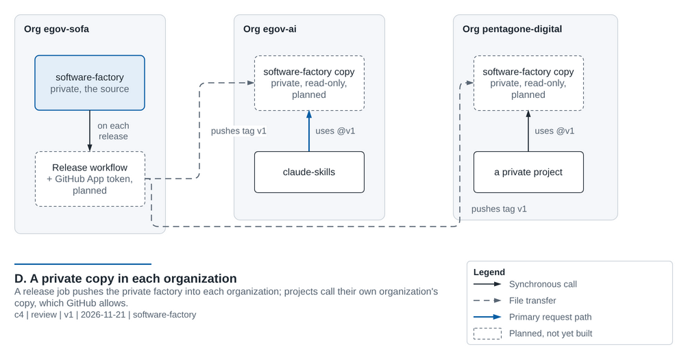
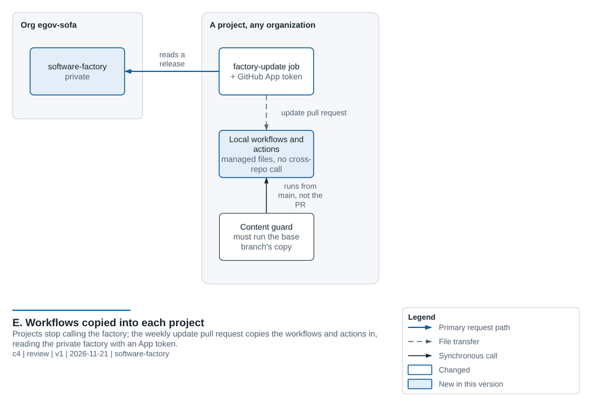

# A private factory for several organizations

**Status:** analysis, 2026-11-21. No decision yet; it answers open question 1 of
[ENTERPRISE-VISION.md](ENTERPRISE-VISION.md#7-open-questions-for-the-next-analysis) and roadmap item E1.6.

**Question:** can the factory become private while projects in the other organizations (`egov-ai`,
`egov-infra`, …) keep using it? The same person owns every one of these organizations.

**Short answer:** not as things are wired today. GitHub decides by the **owner of the repository**, not by the person
who owns the organizations: a private repository shares its workflows and actions with its own organization only,
or with every organization of one **GitHub Enterprise** account. So either the boundary changes (options A and B), or
projects stop calling the factory across it (options C, D and E).

---

## What GitHub allows

From GitHub's documentation (read 2026-11-21 from the `github/docs` repository,
`content/actions/how-tos/reuse-automations/` and `content/actions/reference/workflows-and-actions/reusing-workflow-configurations.md`):

| The private factory is owned by | Its access setting | Who can call its workflows and actions |
|---|---|---|
| a personal account | "Accessible from repositories owned by 'USERNAME' user" | that user's own repositories, not the organizations the user owns |
| an organization | "Accessible from repositories in the 'ORGANIZATION-NAME' organization" | repositories of that organization only |
| an organization owned by an enterprise account | allows workflows in other internal or private repositories | "repositories owned by the same organization, or by any organization owned by the enterprise" |

Three rules of the enterprise case matter here:

- **Both internal and private factories can be shared.** GitHub: "Any actions or reusable workflows stored in the
  internal or private repository can be used in workflows defined in other internal or private repositories owned by
  the same organization, or by any organization owned by the enterprise."
- **But they serve different callers.** "Actions and reusable workflows stored in internal repositories cannot be used
  in public repositories and actions and reusable workflows stored in private repositories cannot be used in public or
  internal repositories." So:

  | Factory | Private projects | Internal projects | Public projects |
  |---|---|---|---|
  | internal | yes | yes | no |
  | private | yes | **no** | no |

  A private factory is the stricter choice, but a project made `internal` (a usual default for shared code in an
  enterprise) can no longer call it: its run fails with "workflow was not found".
- **Public repositories lose access** in any option that keeps the factory non-public and calls it directly.

**Price.** GitHub's pricing page (2026-11-21): Enterprise **$21 per user / month**, Team $4. It includes an
"Enterprise Account to centrally manage multiple organizations".

**How people are counted** (GitHub's billing documentation, read 2026-11-21 from `github/docs`:
`content/billing/reference/github-license-users.md`, `data/reusables/enterprise-licensing/unique-user-licensing-model.md`,
`data/reusables/billing/metered-license-measures.md`):

- **Once per person, across the whole enterprise.** "Each user only consumes one license, no matter how many [GitHub
  Enterprise Server] instances the user uses, or how many organizations the user is a member of." You alone, owner of
  `egov-sofa`, `egov-ai`, `egov-infra` and the others, are **one license: $21 a month, $252 a year**, not one per
  organization. Each other person who is a member of any organization adds one.
- **Who is billed:** organization members and owners; enterprise owners who are a member of at least one of its
  organizations; outside collaborators on private or internal repositories (each counted once, however many
  repositories); dormant members.
- **Who is not:** enterprise owners who belong to no organization, billing managers, outside collaborators on public
  repositories, people added to the enterprise but to none of its organizations. GitHub Apps (the docs-drift and update
  jobs' tokens) are not user accounts, so they take no license; a "machine user" account would.
- **Usage-based billing:** each month you pay for the distinct people who held a license at some point that month,
  pro rata from the day they started. Pending invitations take no license.
- **The Team plan goes away** for an organization that joins: it is billed through the enterprise, so `egov-infra`
  would not pay $4 and $21 for the same person.

**Trial.** A 30-day trial needs no payment method and gives up to 50 licenses. Existing organizations can be
transferred into it, and their own billing is paused during the trial. Two limits: an organization with a GitHub
Marketplace app installed (free or paid) cannot be transferred, and organizations created during the trial cannot
leave the enterprise until it is bought. A trial is enough to test option A with real projects before paying
(`content/admin/overview/setting-up-a-trial-of-github-enterprise-cloud.md`).

### True of every private option

- **The weekly update job needs a token.** `factory-update` clones the factory without credentials
  (`scripts/factory_update_job.py`, step `prepare`). A private factory needs a read token: the pattern that already
  works is the docs-drift job's **GitHub App, one installation per owner**, used through
  `actions/create-github-app-token`. Being allowed to *call* a workflow does not let a job *clone* the repository.
- **People need read access** to install the agents and skills (`install.sh`, or a plugin marketplace).
- **The docs change.** SHARED-SERVICES.md and CUSTOMIZING.md say the factory is public; templates use
  `{{FACTORY_REPO}}`, read from the factory's git remote, so new projects follow whatever repository they were made
  from.
- **Unchanged:** the Claude services' federation rules (they match the calling repository), the content guard's
  logic, and the release flow.

---

## The options

### A. One GitHub Enterprise account


Create an enterprise account, invite the organizations into it, set the factory's access to the enterprise. Calls stay
`egov-sofa/software-factory/…@v1`: **no change in any project**.

**Internal or private factory?** Make it **internal** if any project is or may become internal: it serves internal and
private projects, and its content is visible to the enterprise's members only, never to the public. Keep it **private**
only if every calling project stays private.

- **For:** the native answer; nothing to build or keep in sync. The enterprise also brings what E1 needs anyway:
  rulesets and policies for every organization, the audit log, single sign-on.
- **Against:** $21 per person per month, counted once across all organizations (you alone: $252 a year). Public
  repositories can no longer call the factory, nor internal ones if the factory is private; a public project would
  keep its own copy of the workflows (option E for that project only).
- **Effort:** S. Settings plus the update job's App token. Step by step: [Setting up option A](#setting-up-option-a).

### B. Every repository in one organization


Transfer the repositories into `egov-sofa` (GitHub redirects the old URLs), set access to the organization.

- **For:** free; no new machinery.
- **Against:** gives up separate organizations: separate members, billing, settings and secrets per client or
  activity. It also contradicts claude-skills' exit plan, which keeps work skills movable to another organization.
- **Effort:** S per repository, but federation rules and Terraform must follow each transfer (the OIDC subject
  carries the owner ID).

### C. A public engine and a private factory


Split the repository by what must be secret. A small **public `factory-engine`** keeps the reusable workflows,
actions and their scripts: generic code with nothing about the organizations or clients in it, already checked by the
content guard. The **private `software-factory`** keeps the standards, agents, skills, templates, plans and roadmap.
Projects call the engine as today; the managed files (standards, hooks, the `AGENTS.md` block) still arrive through
the weekly update pull request, which reads the private factory with the App token.

- **For:** free; every organization and public repositories keep working; only what needs secrecy is secret.
- **Against:** two repositories and two release lines to keep in step; a one-time move of the workflows and a
  `uses:` change in every project (one update pull request).
- **Effort:** M.

### D. A private copy in each organization



On each release, the factory's Release workflow (with a GitHub App installed in every organization) pushes the new
tags into a private, read-only `software-factory` in each organization. A project calls its own organization's copy,
which GitHub allows.

- **For:** free; no project loses access; each organization can be audited on its own.
- **Against:** one copy per organization to create, protect and keep current; a failed push leaves one organization
  behind; projects of different organizations name different repositories (`{{FACTORY_REPO}}` already supports this).
- **Effort:** M.

### E. Workflows copied into each project



Projects stop calling the factory. The update job, which already copies managed files, also copies the workflows and
actions into each project.

- **For:** free; works for any organization and any visibility; a project never depends on reaching the factory at
  run time.
- **Against:** every factory change reaches projects only through an update pull request; workflow files cannot be
  changed by the job's `GITHUB_TOKEN`, so those need a local `/factory-update`. **Security:** the content guard runs on
  `pull_request_target` and today relies on running the factory's copy at the tag. A copy inside the project must be
  taken from the base branch (as the factory's own `content-guard.yml` does with `git show`), never run from the pull
  request's checkout.
- **Effort:** M to L.

---

## Comparison

| | A. Enterprise | B. One org | C. Public engine | D. Copy per org | E. Copied in |
|---|---|---|---|---|---|
| Factory content private | all | all | all but the engine | all | all |
| Separate organizations kept | yes | **no** | yes | yes | yes |
| Public projects can use it | **no** | **no** | yes | **no** | yes |
| Internal projects can use it | if the factory is internal | n/a (no enterprise) | yes | n/a (no enterprise) | yes |
| Change in projects | none | transfer | one `uses:` change | repo name | workflows become files |
| New machinery | App token | none | App token, second repo | App, copies, sync | App token, guard change |
| Cost | $21/person/month, once across all orgs | free | free | free | free |
| Effort | S | S per repo | M | M | M–L |

## Recommendation

It depends on **what has to be private**:

- **Mainly the standards, agents, plans and roadmap** (the enterprise strategy, client lists): **C**. The workflows
  are generic and already guarded, so the public engine costs nothing in secrecy, and nothing else changes for
  projects.
- **Everything, and E1 is going ahead** (rulesets, audit, single sign-on across organizations): **A**. It is the one
  option with nothing to build, and it pays for E1 at the same time. Keep any public project on option E.
- **B** only if separate organizations are not needed after all. **D** and **E** work, but add machinery that A and C
  avoid.

---

## Setting up option A

The steps in order. **You** do steps 1 to 4 in GitHub's settings. The factory's maintainers (with Claude) do steps 5
and 6 in this repository. Step 7 comes **only after** 5 and 6 are merged and released, otherwise the weekly update job
breaks in every project. The commands use the GitHub CLI (`gh`), logged in as an owner of the organizations.

Sources: GitHub's documentation, read 2026-11-21 from `github/docs`: the Enterprise Cloud trial, adding organizations
to an enterprise, sharing actions and workflows with an enterprise, repository Actions settings and setting repository
visibility.

### How to check what is public, private or internal

**A repository** has one of three visibilities: `public`, `private` or `internal`. `internal` exists only in an
organization that belongs to an enterprise.

| Where | How | What you see |
|---|---|---|
| Its page on github.com | The label next to the repository's name | `Public`, `Private` or `Internal` |
| Its settings | **Settings → General → Danger Zone → Change repository visibility**: the text says what it is now | "This repository is currently public" (or private, internal) |
| Command line | `gh repo view OWNER/REPO --json visibility --jq .visibility` | `PUBLIC`, `PRIVATE` or `INTERNAL` |
| REST API | `gh api repos/OWNER/REPO --jq .visibility` | `public`, `private` or `internal` |
| From outside | Open `https://github.com/OWNER/REPO` in a private browser window, logged out | The page shows: public. "404 Not Found": private or internal |

The logged-out check is the one that proves what a stranger sees; the others need you to be logged in.

**Every repository of an organization at once**, with its visibility:

```bash
gh repo list ORG --limit 1000 --json nameWithOwner,visibility --jq '.[] | "\(.visibility)\t\(.nameWithOwner)"'
```

Only the public ones: `gh repo list ORG --visibility public --limit 1000`.

**An organization** has no visibility of its own: it is not public or private. Its profile page
(`https://github.com/ORG`) is always visible to everyone, and it lists only the organization's **public**
repositories (and the members who chose to show their membership). What you can check for an organization:

| Question | How |
|---|---|
| Which repositories are public? | The command above, or the organization's page while logged out: it lists only public repositories |
| Which plan is it on? | **Organization → Settings → Billing and licensing** (owners only). Or `gh api orgs/ORG --jq .plan.name` (owners only) |
| Does it belong to an enterprise? | The enterprise's **Organizations** tab lists it. Only an organization in an enterprise offers `Internal` when you create a repository |

**Who may call the factory** (once it is private or internal):

```bash
gh api repos/egov-sofa/software-factory/actions/permissions/access --jq .access_level
```

It prints `none`, `user`, `organization` or `enterprise`. Option A needs `enterprise`. The same setting is in
**Settings → Actions → General → Access**; it only appears on a private or internal repository.

**On a public repository** the command fails with `Access policy only applies to internal and private repositories.
(HTTP 422)`. That is not an error to fix: it confirms the repository is still public, which is the expected answer for
the factory until step 7.

### Step 1. Before you start (10 minutes)

1. **Find the repositories that call the factory, and their visibility.** In each organization:

   ```bash
   gh search code "egov-sofa/software-factory" --owner ORG --json repository,path --jq '.[] | "\(.repository.nameWithOwner)\t\(.path)"'
   ```

   Then check each repository's visibility with the commands above. A **public** caller loses access once the factory
   is not public: make it private or internal, or give it its own copy of the workflows (option E for that project
   only).
2. **Check each organization's installed apps:** **Organization → Settings → GitHub Apps**. An organization with a
   GitHub Marketplace app installed (free or paid) cannot be moved into a **trial** enterprise. If a check on
   `https://github.com/marketplace` shows an installed app is listed there, either remove it during the trial or skip the
   trial and buy Enterprise directly.
3. **Choose the factory's future visibility** (see [option A](#a-one-github-enterprise-account)): **internal** if any
   caller is or may become internal; **private** only if every caller stays private.
4. **Note the factory's current state**, to compare later: `gh repo view egov-sofa/software-factory --json visibility`
   prints `PUBLIC`, and the `access_level` command above answers HTTP 422 because the factory is public.

### Step 2. Create the enterprise account (trial)

1. Open the trial page:
   `https://github.com/account/enterprises/new?ref_product=ghec&ref_type=trial&ref_plan=enterprise`.
2. Choose an enterprise with **personal accounts**, not **Enterprise Managed Users**: with managed users, existing
   organizations cannot be added.
3. Give it a name and finish. No payment method is needed. The trial lasts 30 days with up to 50 licenses.

**Check:** `https://github.com/enterprises/<your-enterprise>` opens and shows you as owner.

### Step 3. Add the organizations

For each organization (`egov-sofa`, `egov-ai`, `egov-infra` and the others):

1. In the enterprise, open **Organizations → Invite organization**, type the organization's name, select it and click
   **Invite organization**.
2. As the organization's owner you get an email: accept the invitation.
3. Back in the enterprise's **Organizations** tab, click **X pending**, then **Approve** next to the organization.

URLs do not change. The enterprise's policies now apply to the organization, and its plan is billed through the
enterprise.

**"Organization … cannot be invited because it has an outstanding balance":** the organization has an unpaid invoice,
typically a failed payment on a paid plan (Team). Pay it in **Organization → Settings → Billing and licensing**
(update the payment method first if the card failed), wait a few minutes and invite it again. If the amount looks wrong,
contact GitHub Support from the same page. Meanwhile add the other organizations, and do not do step 7 until this one
has joined if any of its repositories call the factory.

**Check:** the enterprise's **Organizations** tab lists every organization. In any of them, **New repository** now
offers an `Internal` visibility.

### Step 4. Check the enterprise's Actions policies

In the enterprise: **Policies → Actions**.

1. **Allowed actions and reusable workflows:** they must still allow what the factory and its callers use: the
   factory's own workflows and actions, and the public actions it pins (`actions/checkout`,
   `actions/create-github-app-token` and the others). "Allow all actions and reusable workflows" works; a stricter
   setting must list them.
2. **Workflow permissions:** if an organization gave workflows **read and write** permission before, set it again at
   enterprise level; GitHub does not carry it over when an organization joins.

**Check:** re-run any workflow in `egov-ai/claude-skills` that calls the factory. The factory is still public at this
point, so it must pass exactly as before.

### Step 5. Give the weekly update job a GitHub App token (factory change)

`factory-update` clones the factory without credentials; that fails once the factory is not public. The job will
create a token with `actions/create-github-app-token` for a GitHub App installed on `egov-sofa` with **Contents: read**
on `software-factory` only, like the docs-drift job. You create or choose the App and store its ID and private key as
secrets where the job runs; the change itself is made in the factory and released.

### Step 6. Update the docs (factory change)

SHARED-SERVICES.md and CUSTOMIZING.md still say the factory is public and must stay public. They are rewritten for an
internal or private factory inside the enterprise, in the same release as step 5.

### Step 7. Change the factory's visibility and share it

Only after steps 5 and 6 are released.

1. Change the visibility, in **Settings → General → Danger Zone → Change repository visibility**, or:

   ```bash
   gh repo edit egov-sofa/software-factory --visibility internal --accept-visibility-change-consequences
   ```

   (`--visibility private` if every caller stays private.) GitHub's consequences: stars and watchers are erased;
   public forks stay public and are detached, so **what was already public stays public in them**; internal makes the
   repository readable by every member of the enterprise.
2. Share it with the enterprise: **Settings → Actions → General → Access**, choose "Accessible from repositories in
   the '<enterprise>' enterprise", click **Save**. Or:

   ```bash
   gh api -X PUT repos/egov-sofa/software-factory/actions/permissions/access -f access_level=enterprise
   ```

**Check:** `gh repo view egov-sofa/software-factory --json visibility` prints `INTERNAL` (or `PRIVATE`), the
`access_level` command above prints `enterprise`, and the repository's URL gives "404 Not Found" in a logged-out
browser window.

GitHub's warning: outside collaborators on a calling repository can read the logs of runs that use the factory's
workflows.

### Step 8. Test, in this order

1. Re-run a workflow in `egov-ai/claude-skills` that calls the factory at `@v1`: it must pass.
2. Open a small pull request in a private or internal repository of `egov-infra`: the content guard and the Claude
   review must run. The Claude review needs no Console change: its federation rules match `repository_owner` and its
   ID, which joining an enterprise does not change.
3. Run `factory-update` once by hand in one project: it must clone the factory with the App token and finish.

**If anything breaks:** make the factory public again (`gh repo edit egov-sofa/software-factory --visibility public
--accept-visibility-change-consequences`); every caller works again at once. Stars and watchers do not come back.

### Step 9. Before the trial ends

Buy Enterprise before day 30, or the trial expires and the enterprise is deleted 90 days later. Organizations
**transferred** into the trial can leave it; organizations **created** during the trial cannot leave until it is bought.
Cost: $21 a month for you, plus $21 for each other member of any of the organizations (see
[How people are counted](#what-github-allows)).

## To decide

1. What must not be public: the whole factory, or its standards, agents and plans only?
2. Do any public repositories need the factory's workflows?
3. Is GitHub Enterprise acceptable: $21 per person per month, each person counted once whatever the number of
   organizations ($252 a year for you alone), given that E1 needs most of what it brings? A 30-day trial can test it
   first.
4. Which GitHub App do the update job (and later the release workflow) use: the docs-drift App, or a new one with
   only `contents: read` on the factory?
