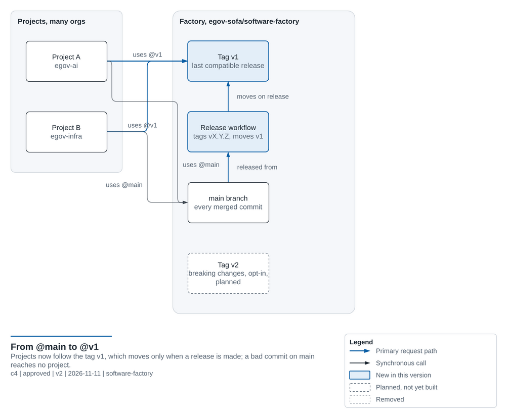
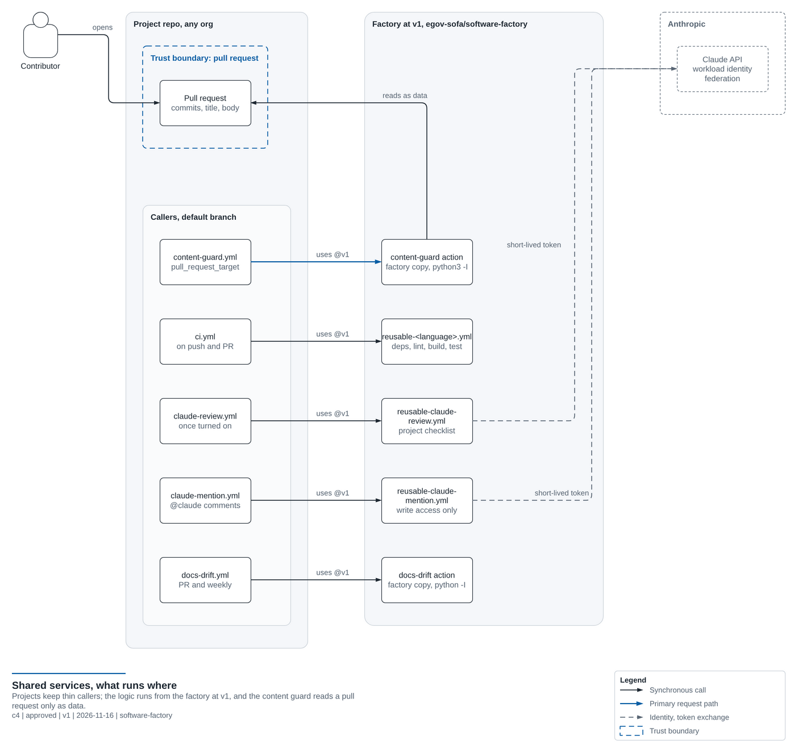
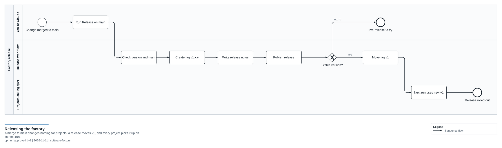
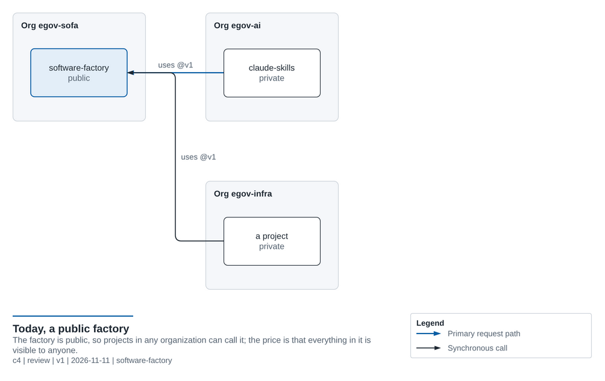
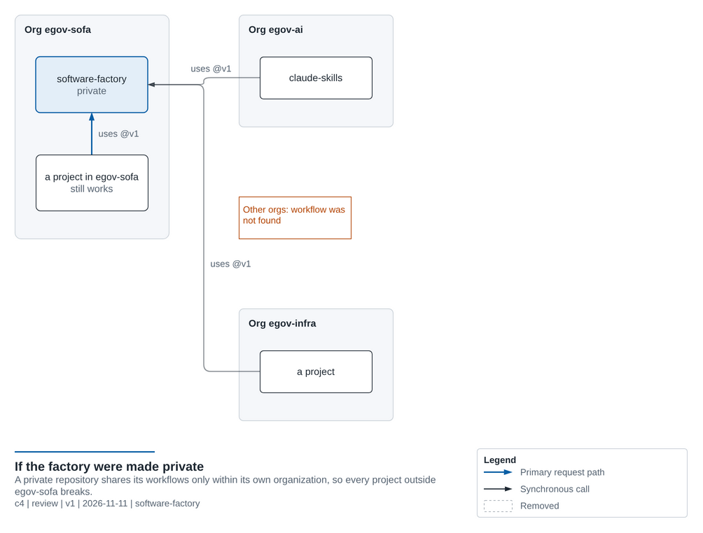

# Shared Services: the factory as a platform

**Decision (2026-11-11):** my other repositories, starting with `claude-skills`, use services provided by the software
factory, but only as **opt-in, versioned building blocks**. The factory does not own them. Anything only one project
needs stays in that project.

This page records why, the rules that keep the coupling safe, and which services exist. The work that follows from it
is tracked in [ROADMAP.md](ROADMAP.md).

---

## Why share at all

I am one person maintaining several repositories. Without a shared source, I would solve the same problems in each
one: pinning actions, setting up Claude review and its authentication, guarding against leaked secrets and internal
names, Dependabot, standard CI steps. `claude-skills` shows the cost: its review workflow, federation auth and content
guard took many pull requests to get right (see its `docs/roadmap.md`). Rebuilding that in every new repository would
be wasted work, and the copies would slowly diverge.

## The risk, and how it is managed

The danger is **coupling**. If every project follows the factory's `main`, one bad push breaks all of them at once.
If the factory tries to fit every project's quirks, its workflows grow inputs nobody understands. Four rules prevent
both:

1. **Pin versions.** Projects call `…/reusable-claude-review.yml@v1`, never `@main`. `v1` is a moving tag that only
   receives compatible changes. A breaking change gets `v2`, and each project moves when I choose.
2. **Share only what is the same everywhere.** Rule of thumb: centralize something once two or three projects need it
   *in the same form*. Domain-specific logic stays local.
3. **Keep each service small.** One job per reusable workflow or action, so a project can take the Claude review
   without the CI pipeline, or the reverse.
4. **Always leave an escape route.** Any project can replace a `uses:` line with a local copy and diverge. Nothing
   locks it in.

The first rule fixed a real problem. Before #2, every project followed `main`; now each follows `v1`, which moves only
on a release:



## Who uses what

| Project | Uses from the factory | Keeps locally |
|---|---|---|
| New projects (from `new-project.sh`) | CI pipeline, Claude review, `@claude` mentions, content guard, hooks, standards | Their code, their `AGENTS.md` and review checklist |
| Existing projects (via `/factory-onboard`) | The same, chosen one by one | Anything they already do differently |
| `claude-skills` | Claude review, `@claude` mentions, content guard; later the evals runner, Dependabot setup and lint jobs | `validate.py`, `build.py`, taxonomy and catalog, draw.io golden PNG tests, skill packaging and release zips, `version_check.py`, its skill eval cases |

Most of the shared column was **built first in `claude-skills`**. The order of work is therefore: move it into the
factory, generalize it, then let `claude-skills` use it. That makes `claude-skills` the first real user of the
factory, which is the best test it can get.

## When a project should evolve on its own

Do not adopt the factory's services when:
- the project has unusual CI needs that would force project-specific options into a shared workflow
- it is short-lived (a spike or a throwaway prototype)
- it will move to someone else's infrastructure. For example, work skills that may move to an employer's repository
  must not depend on my personal factory.

---

## The services

All of them are referenced as `egov-sofa/software-factory/...@v1`. Templates already contain the callers; for an
existing project, copy the caller files from [`templates/_shared/`](../templates/_shared/) or run `/factory-onboard`.

| Service | Kind | What it does | Caller file in projects |
|---|---|---|---|
| CI pipeline | reusable workflow: `reusable-node.yml`, `reusable-python.yml`, `reusable-generic.yml` (all take a `working-directory`) | Install, lint, build, test | `.github/workflows/ci.yml` |
| Claude review | reusable workflow: `reusable-claude-review.yml` | Claude Code reviews each pull request against the project's checklist and posts inline comments plus a summary | `.github/workflows/claude-review.yml` |
| Claude on demand | reusable workflow: `reusable-claude-mention.yml` | Answers a pull request comment starting with `@claude` (write access only) | `.github/workflows/claude-mention.yml` |
| Content guard | composite action: `.github/actions/content-guard` | Blocks secrets, public IP addresses, internal host names and denylisted terms in a pull request | `.github/workflows/content-guard.yml` |
| Local hooks | managed files in the project, kept current by `/factory-update` | Run the same guard before each commit | `scripts/hooks/`, `scripts/check_content.py` |
| Standards | managed files in the project, kept current by `/factory-update` | The factory's standards, read by every AI tool (through the `AGENTS.md` block), the agents and the Claude review (from the base branch) | `.factory/standards/*.md` |
| Updates | script: `scripts/factory_update.py`, run by `/factory-update`; composite action: `.github/actions/factory-update` (weekly) | Brings a project to a newer factory release: managed files replaced, merged files merged 3-way, seeded files left alone (see below). Every Monday the action proposes the newest release as a pull request | `.factory/answers.yml`, `.github/workflows/factory-update.yml` |
| Docs drift | composite action: `.github/actions/docs-drift` | A kind of Dependabot for documentation: reports documents whose sources changed after them, on pull requests and as a weekly issue. Does nothing until the project adds `.factory/docs.yml`. Setup and the private dashboard of all projects: [DOCS-DRIFT.md](DOCS-DRIFT.md) | `.github/workflows/docs-drift.yml` |



### Updating the files copied into a project

The caller workflows, the content guard's local copy, its hooks and the standards are files in the project, so `@v1`
alone does not update them. [`scripts/new-project.sh`](../scripts/new-project.sh) records what it rendered the project
from in `.factory/answers.yml` (the factory repository, commit and release, the template and the names), and
`/factory-update` ([`scripts/factory_update.py`](../scripts/factory_update.py)) renders that release and the new one
again, then treats each file by its kind, declared in [`templates/file-kinds.txt`](../templates/file-kinds.txt):

| Kind | Files | What an update does |
|---|---|---|
| **managed** | `scripts/check_content.py`, `scripts/hooks/*`, `.factory/standards/*.md` | Replaces it whole; a local change is lost and reported. The file starts with a "Managed by software-factory" header |
| **merged** | `.github/workflows/*.yml`, `.github/dependabot.yml`, the PR template, `.editorconfig`, `.gitattributes`, `.gitignore`, `CLAUDE.md`, `eslint.config.js`, `tsconfig*.json` | Merges the factory's change with the project's edits (`git merge-file`); overlapping edits are left as conflict markers |
| **seeded** | everything else: `AGENTS.md`, `README.md`, `package.json`, `pyproject.toml`, the code and tests | Never touched, except the block between the `software-factory:standards` markers in `AGENTS.md` and the review checklist |

A file the factory removed is deleted when the project never changed it, and kept (and reported) otherwise; a seeded
file is never deleted. A file listed under `skip:` in the answers file is never added or updated. Updates stay on the
project's major version unless `--to` names another. `factory_update.py check` exits 1 when a managed file was
edited and 3 when a newer release exists. Projects made before this have no answers file: `/factory-update` infers
one (`adopt`) and asks the user to confirm it; `/factory-onboard` writes it for the projects it onboards.

#### The weekly update pull request

New projects get `.github/workflows/factory-update.yml`, which calls the `factory-update` action every Monday (and on
demand). The action ([`scripts/factory_update_job.py`](../scripts/factory_update_job.py)) clones the factory named in
`.factory/answers.yml` without a token, runs its own copy of `factory_update.py` on the checkout, and:

- does nothing when the project has no answers file (a notice), or when an open pull request already proposes that
  release;
- skips a release you declined: its update pull request closed without merging, or its `factory-update` issue closed
  as **not planned** (the job closes its own issues as completed, so only "not planned" counts). The next release is
  proposed as usual;
- when the project is at or past the newest release of its major version (a local `/factory-update`, a merged
  update), closes any open update pull request and the `factory-update` issue with "The project is at <version> now";
- otherwise pushes `factory-update/<version>` and opens a pull request with the summary, the conflicts (the pull
  request is then a draft; where drafts are not available, as in private repositories on GitHub Free, a normal one
  titled `[conflicts] …`), the decisions needed and the release notes' headlines, and closes any older update pull
  request and the `factory-update` issue with a comment pointing at the new one. An open issue does not stop this:
  every run tries the pull request again, so it opens once the repository setting below is turned on.

The caller has `contents: write`, `pull-requests: write` and `issues: write`, and no secret: only `GITHUB_TOKEN`,
which brings three limits:

| Limit of `GITHUB_TOKEN` | What the job does |
|---|---|
| It cannot create or change files under `.github/workflows/` | Leaves those changes out and lists them in the body with "run `/factory-update` locally". The pull request records the new version as usual, plus `_workflows_from` in `.factory/answers.yml`: the factory commit the workflow files are still at. Updates merge the workflow files from that commit and every other file from `_commit`, so a merged update pull request is never proposed again; a local `/factory-update` brings the workflow files in and removes the key. While only workflow files are pending, the job keeps one issue open instead of a pull request |
| A pull request it opens starts no workflows | The body says CI has not run and how to start it: close and reopen the pull request, or push a commit to it |
| It may open pull requests only when the repository (or organization) setting **Settings → Actions → General → Workflow permissions → "Allow GitHub Actions to create and approve pull requests"** is on; it is off by default | Falls back to one issue labelled `factory-update` with the same summary, naming the setting; the branch is pushed, so a person can open the pull request from it. A later run never overwrites a branch already on GitHub, so commits pushed to it (conflict resolutions) are kept |

Nothing from the project runs: the scripts come from the action at its tag and run with `python3 -I`, every git
command runs with `core.hooksPath=/dev/null` (and `--no-verify` for the commit), the checkout keeps no credentials,
and the token is given only to the step that pushes and calls `gh`.

### Why the content guard is an action, not a reusable workflow

The guard must run code that comes from the factory, never from the pull request it checks. A composite action gets
its own files at the pinned tag (`$GITHUB_ACTION_PATH`), so the script that runs is the factory's `v1` copy, outside
the checkout, in isolated mode (`python3 -I`). A reusable workflow has no reliable way to find its own repository's
files. The caller runs on `pull_request_target`, so GitHub also takes the caller workflow from the base branch: a pull
request cannot edit the check it is held to, or read the denylist secret.

### Turning on the Claude services

The Claude review costs API credit on every push, so it is **off until you turn it on**. Per repository:

1. Install the Claude GitHub app on the repository: <https://github.com/apps/claude> (or `/install-github-app` in
   Claude Code).
2. Give it access to the Claude API with **workload identity federation**, which stores no secret: federation rules
   for the repository, and their IDs as repository variables. `/factory-new` and `/factory-onboard` prepare this and
   hand an organization admin one command:
   ```bash
   python3 scripts/claude_federation.py --repo OWNER/NAME --mention --review-workflow-ref ... --apply --set-variables
   ```
   It creates the review and mention rules through the Admin API and sets the variables, `CLAUDE_REVIEW_ENABLED`
   last. The full command, the architecture and a troubleshooting table are in
   [CLAUDE-SERVICES-AUTH.md](CLAUDE-SERVICES-AUTH.md#set-up-a-repository-from-claude-code-recommended); the Claude
   Console is the way to do it by hand.
3. Without `--set-variables`, set the variables yourself with the commands the script prints, and
   `CLAUDE_REVIEW_ENABLED` to `true` last.
4. `@claude` mentions use the mention rule (`--mention`), with its ID in `ANTHROPIC_MENTION_FEDERATION_RULE_ID`.
   Until it is set, mentions are ignored.

Turning on `CLAUDE_REVIEW_ENABLED` before the rules and the other variables exist makes every review fail with "Environment variable validation failed", as it did on
egov-sofa/software-factory#6.

Each project edits **its own** checklist in `.claude/skills/pr-review/SKILL.md`. The review always reads it from the
default branch, so a pull request cannot change how it is reviewed. The label `skip-review` skips the review for the
pushes that follow, and a project's caller can add `paths-ignore` for files that never need one.

When a review fails without a reason, set the variable `CLAUDE_REVIEW_DEBUG` to `true`, rerun, read the log, then
delete the variable.

### Turning on the denylist

Built-in rules (secrets, public IPs, internal hosts) work with no setup. To also block customer, employer or internal
system names:

1. Write them in `.content-denylist` at the project root, one per line (the file is git-ignored).
2. Store the same list as a secret: `gh secret set CONTENT_DENYLIST < .content-denylist`.

Findings never print a denylisted term, only its number. On a fork's pull request they don't show the number or the
location either, only that denylisted terms were found: otherwise a fork could put one guessed name per line and learn
from the failing lines which names are on the private list. A maintainer sees the details by running the guard
locally.

A line ending in `content-ok` skips the built-in rules. If it holds something that looks like a secret, the guard
still passes it but prints a note naming the kind of secret, so the reviewer can check that it is a fake.

---

## Versioning and releases of the factory

- Every merge to `main` is **not** a release. A release is a tag `vX.Y.Z` on `main`.
- The [Release workflow](../.github/workflows/release.yml) checks the tag is on `main`, publishes release notes grouped
  by Conventional Commit type, and moves the major tag (`v1`) to the new release.
- Before any tag is created or moved, it refuses a release that would not move forward
  ([release-check.sh](../scripts/release-check.sh)): the version must be newer than the latest release of the same
  major, and the commit must contain the one `v1` points to now. It also waits for the **Factory self-test** to have
  passed on `main` for that commit: right after a merge, wait for the self-test to finish, then release.
- **Compatible** change (new optional input, a fix, a stricter check that existing projects pass): minor or patch
  release, `v1` moves, every project picks it up on its next run.
- **Breaking** change (a removed or renamed input, a new required secret, different behavior a project relies on):
  major release `v2`. `v1` stays where it was until each project chooses to move.



Two ways to release:

- **From GitHub (no terminal):** Actions → **Release** → *Run workflow*, branch `main`, version `v1.1.0`. The workflow
  creates the tag itself. Claude can start it the same way, which matters in cloud sessions: they may push only
  their own working branch, never a tag.
- **From a terminal:**
  ```bash
  git checkout main && git pull
  bash scripts/release-notes.sh v1.1.0   # preview
  git tag -a v1.1.0 -m "Short description"
  git push origin v1.1.0
  ```

Do not create the tag with GitHub's "Draft a new release" button: the workflow would then try to create a release
that already exists.

## Who can call the factory

The factory repository (`egov-sofa/software-factory`) is **public**, so any repository can call its services with no
setup on the factory side. Two things follow:
- Everything in the factory is public: keep employer and customer details out of it.
- Each calling repository must allow it under its own Settings → Actions → General → *Actions permissions*: "Allow
  all actions and reusable workflows", or the "select" option with `egov-sofa/software-factory/*` added. This matters
  for `egov-ai/claude-skills`, which lives in another organization.



If the factory is ever made private, it can only serve repositories of the same owner: private workflows cannot be
shared across organizations. See [CUSTOMIZING.md](CUSTOMIZING.md#why-the-factory-repo-is-public).



The way out, if the factory must stop being public, is one GitHub Enterprise account with internal repositories; it is
open question 1 of [ENTERPRISE-VISION.md](ENTERPRISE-VISION.md#7-open-questions-for-the-next-analysis).
